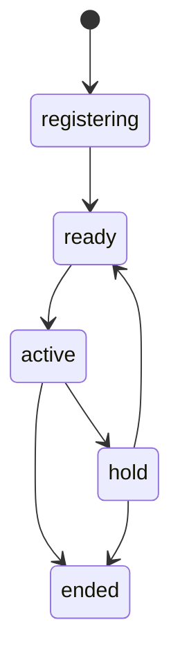

# AGENT LIFECYCLE

Lifecycle transitions carry stable event ID, mission milliseconds, old/new state and reason. A provider exception enters hold and produces an error report. A later valid input retries through ready. The terminal state prevents further actions. Offline operation conservatively prohibits movement. Degradation is tracked separately from lifecycle.

