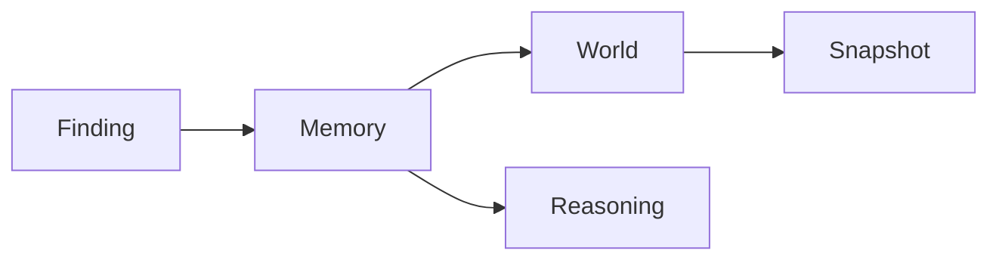

# AGENT MEMORY

Each instance owns a bounded finding index, decision/outcome log, lifecycle history, control history and mock outbox. On each cycle expire findings older than ttl_ms, retain one per observation ID and evict oldest insertion over capacity. recent returns immutable findings. Memory.snapshot and restore serialize findings with owner and mission scope. DroneAgent.snapshot additionally exports runtime history for inspection. Construct a fresh Fleet on mission reset.

