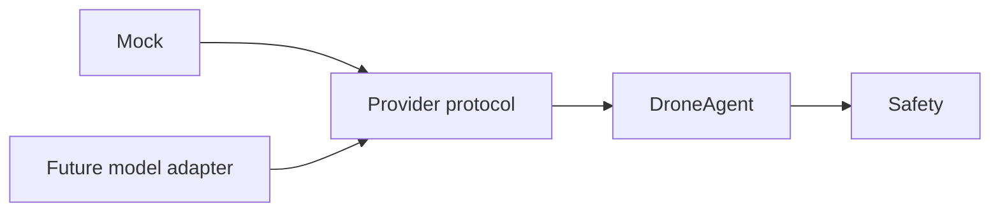

# FUTURE MODEL INTEGRATION

1. Implement one existing protocol in interfaces/providers.py. Perception takes SensorFrame and returns immutable Finding records; resolve media through a scoped dependency. Fusion returns LocalView, reasoning returns Intent and planning returns Action.
2. Validate units, capture times, unknown locations and uncertainty at the adapter boundary. Preserve evidence identity and document provider version and score semantics.
3. Inject the adapter into DroneAgent via perception, fusion, reasoning or planning. Keep mutable adapter state private to each instance. Configure the composition root for any additional provider identifier.
4. Run the Model 1 regression suite with the replacement, including hidden-world replay, missing inputs, provider exceptions and unauthorized movement. Record versions and compare results on identical scenario seeds. The independent controller remains on the execution path.

