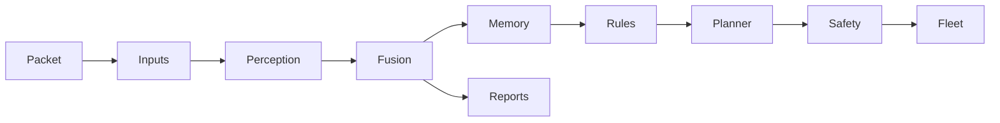
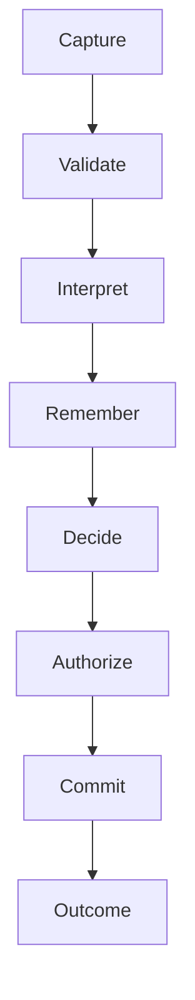

# MODEL 1 IMPLEMENTATION

Fleet constructs a DroneAgent per simulator ID. The adapter retains exclusive access to Engine. It passes a private Packet, current mission milliseconds, link status and public mission constraints. A cycle returns one bounded action. Fleet batches those actions into the simulator barrier and records whether movement was blocked. With movement disabled the default agent observes, requests fresh readings or reports evidence.

