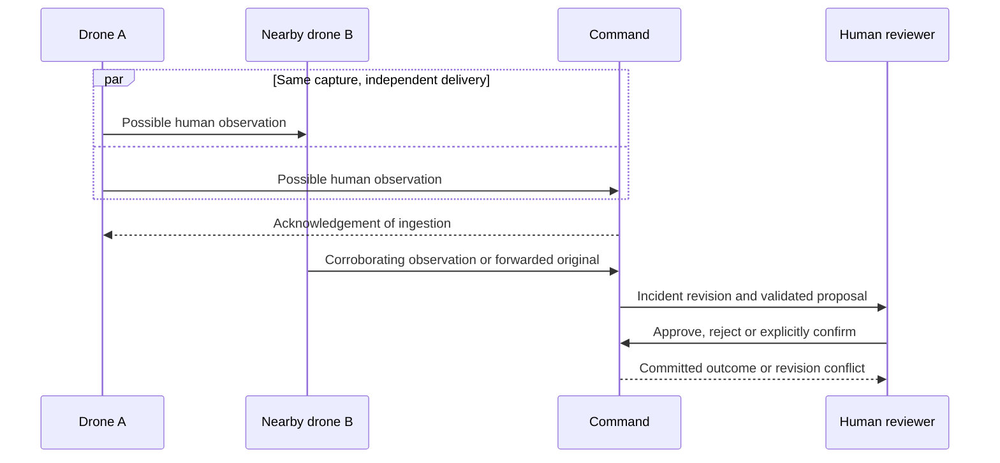

# Communication architecture

A mission-scoped broker models three channels. Nearby drones share observations and hazards. Each drone independently exchanges reports, health and task status with command. Command publishes incident revisions to rescue personnel and receives version-bound decisions. Future transport adapters must preserve these boundaries with separate recipient queues and authenticated identities.

Fan-out shares the observation and correlation IDs. Each destination stream gets a separate envelope and sequence. For group addressing the broker snapshots eligible members at send time and tracks receipt per member. Slow or disconnected recipients cannot stall local safety. Prioritize controls and urgent hazards, reserve capacity for both, coalesce superseded telemetry and log drops. Never acknowledge an acknowledgement. Delivery, ingestion, task completion and human confirmation are distinct events.

Use capture time to order observations and incident revision for decisions. A gap triggers bounded replay from the last contiguous sequence. Delayed historical reports may enrich incident history. Only a currently authorized, unexpired instruction can change task state.
