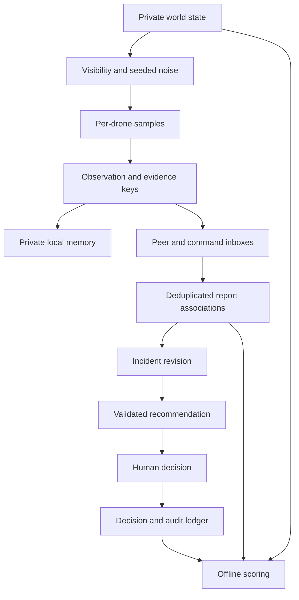

# Data flow and lineage

At capture the sensor assigns evidence IDs, origin and capture tick. The observation adds a reportable location if available. Retries preserve IDs. Independent observations get new evidence IDs even when associated with the same incident. A recommendation refers to a specific immutable revision; a reviewer must refresh after a conflicting update.

The evaluator joins truth to observations after the run. Agent-facing APIs expose only observed coverage and permitted evidence. Operational logs carry correlation IDs, message metadata and rejection codes. Raw artifacts remain in a separate access-controlled store. Experiment exports use synthetic identifiers and omit artifact contents by default.
