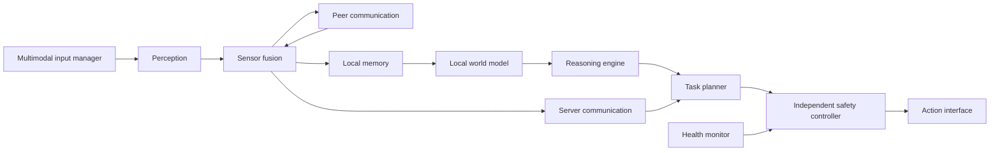

# Model 1 · per-drone intelligence

Each instance has its own mailbox, evidence index, task lease and read-only sensor view. The drone accepts images, video frame references, thermal samples, text, GPS, IMU and environmental readings through modality adapters. Peer observations and central instructions arrive on authenticated logical channels. Unstructured text enters as data and cannot grant authority.

| Module | Input and responsibility | Output or failure behavior |
|---|---|---|
| Input manager | Align capture times to mission ticks, record missing modalities | Scoped SensorFrame and availability flags |
| Perception | Read permitted synthetic samples | Evidence-linked candidate observations |
| Fusion | Combine temporally and spatially compatible samples | LocalView with confidence and conflicts |
| Local memory | Store recent observations by ID and capture time | Bounded history with retained evidence lineage |
| World model | Project observed free, obstructed, hazard and unknown cells | Private sparse map with observation age |
| Reasoning | Select survey, revisit, hold or end from local state | Intent with no direct actuation |
| Planner | Resolve intent against assignment and observed obstacles | One proposed grid action per step |
| Action interface | Submit the safety-filtered action to the scoped environment | Simulation outcome returned next tick |
| Peer communication | Fan out observations within simulated connectivity radius | Independent delivery per eligible peer |
| Server communication | Publish the same observation ID and receive leased tasks | Correlated reports, task status and retry queue |
| Health monitor | Track battery, missing heartbeats and sensor faults | Degraded status or immediate hold |
| Safety controller | Check lease, boundaries, energy reserve and human restrictions | Permit one action, substitute hold, or end |

Local inference may report possible presence. Missing thermal or image data stays missing. Forwarded reports preserve original evidence identities. During a server outage only an existing permitted task may continue until its lease or offline budget expires, whichever comes first. Peer messages cannot renew that lease.

The synthetic sensor owner supplies measured cell (nullable), measured battery and that drone's capture references in SensorFrame. The configured sensor set minus the sample modalities gives the missingness mask. Media providers receive a mission- and principal-bound read capability through injection; a key alone conveys no access. Perception produces Finding values. Environment and hazard findings carry their wire feature/hazard label. Possible-human findings have no label. Preserve these values through fusion, memory and publication. The receiver reconstructs the same Finding from the typed report payload.

Planning receives the current TaskLease. The trusted controller alone holds the submission port and constructs SafetyContext from authenticated restrictions, measured health, link state and lease. The safety controller reads its own measured frame, bypassing learned fusion for time, position and battery. Public grid bounds and conservative energy costs are injected with the policy configuration. A provider may return a safer action; submit only the permitted proposal or a more restrictive hold/end. A provider exception, absent position or lease, or missing offline deadline in offline state precludes movement. The simulator privately checks physical feasibility at commit.
