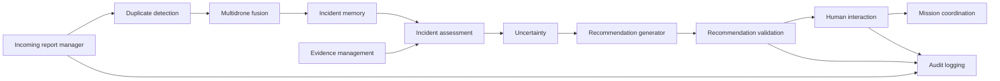
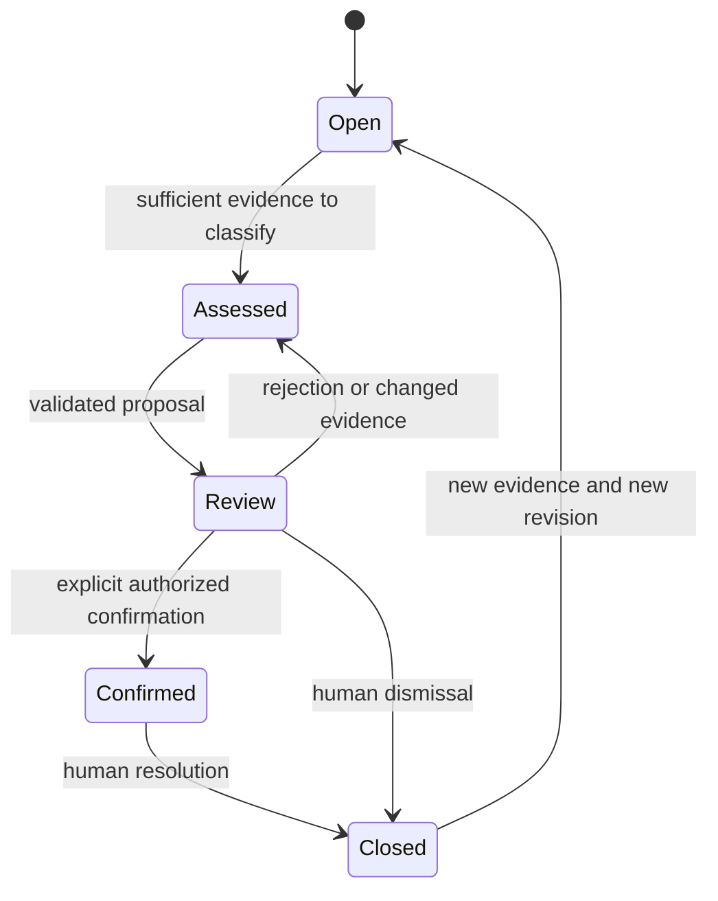

# Model 2 · central rescue command

1. Incoming report manager validates schema, principal, destination, mission and expiry. It records rejected input with a reason.
2. Duplicate detection removes retries by message ID and identifies shared observation lineage across peers.
3. Multidrone fusion groups compatible reports using configured spatial and capture-time tolerances. An ambiguous association remains a candidate link.
4. Incident memory appends a revision for changed findings and retains superseded assessments.
5. Evidence management indexes origin, capture time and artifact visibility. A missing artifact remains unresolved.
6. Assessment assigns routine environmental observation, hazard, possible human presence, uncertain rescue need, suspected emergency or human-confirmed need. A hazard alone cannot establish human presence.
7. Uncertainty management records missing location, conflicting modalities, stale evidence and unknown resources. Repeated copies do not increase confidence.
8. Recommendation generation selects evidence inspection, additional observation or human review of rescue need. Each proposal names the incident revision, evidence, unknowns and expiry.
9. Validation resolves cited evidence within the mission, checks recency and rejects unsupported assertions. Unknown victim condition, geography, resources and access routes stay unknown.
10. Coordination issues scoped simulated search tasks after mission and safety checks.
11. Human interaction presents evidence and alternatives, records approval, rejection, explicit confirmation or override against the viewed revision.
12. Audit logging records inputs, provider version, association decision, validation result, reviewer and revision. Apply human decisions and append audit records atomically.

An incident's workflow is separate from its assessment category. New evidence can reopen a closed incident. Approval to inspect evidence does not confirm rescue need.

The command adapter extracts ReportedFinding from authorized observation envelopes only, preserving the envelope message ID as the revision report reference. Assessment and recommendation providers receive the selected typed findings and their evidence. Control traffic and unrelated incidents stay outside those inputs. The command validator checks returned IDs against that input set and rejects a model-authored human confirmation. Only the human decision transaction can originate confirmation.
