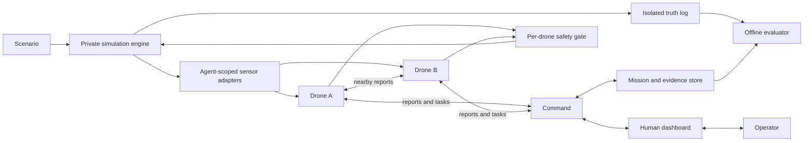
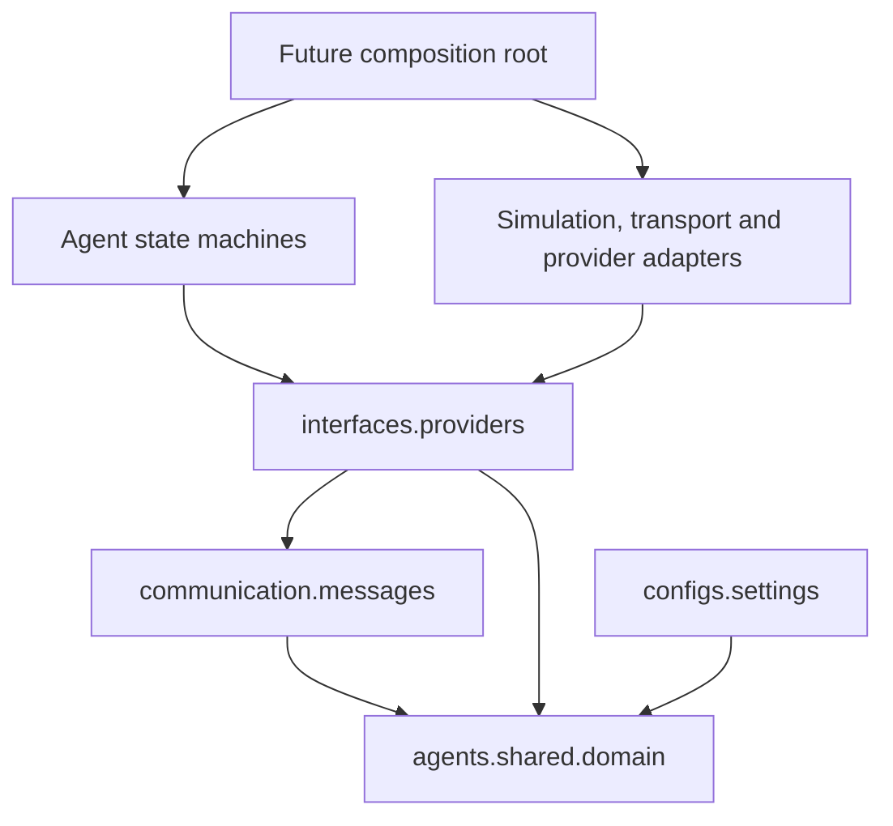

# System architecture

SWARM-AID studies how local sensing and mission-level coordination affect civilian search in synthetic disasters. A mission owns its grid, clock, participants and permissions. A run binds a mission to a seed, configuration and provider manifest. A drone owns its memory for that run. Command can request a survey or evidence review. Only an authorized human can confirm rescue need or change a consequential mission decision.

The composition root constructs the environment and gives each trusted per-drone controller a scoped environment port. Planning and perception see observation values only. Transport serializes messages even in-process so the receiver never holds a mutable reference to the sender. A synthetic sensor adapter resolves artifact keys for its authorized principal. A simulated action changes the world only after policy validation. Model replacement occurs at constructor injection points.

The domain layer contains immutable values. Ports define provider signatures. Concrete mock, rule-based, pretrained, cloud, custom-trained and reinforcement-learning adapters can implement the same ports. Their outputs pass the same validators. Phase 1 supplies values, ports and configuration. Each arrow involving a running agent describes planned behavior.
