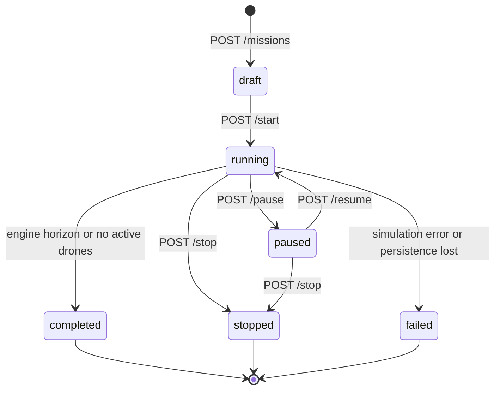

# API reference and human oversight API

Interactive documentation is served by the running backend at `http://127.0.0.1:8000/docs` (Swagger UI), `/redoc` and `/openapi.json`. The OpenAPI document lists 80 operations on 76 paths; this page summarizes them and the conventions they share.

## Conventions

- Base path `/api/v1`. JSON request and response bodies. Requests reject unknown fields (422).
- Authentication: `Authorization: Bearer <access token>` (see [SECURITY.md](SECURITY.md)). Public endpoints: `/health/live`, `/health/ready`, `/api/v1/auth/login`, `/auth/refresh`, `/auth/machine-token`.
- Pagination: `?limit=` (default 50, maximum 500) and `?offset=`; list responses are `{"items": [...], "total", "limit", "offset"}`.
- Errors: `{"error": {"code", "message", "request_id", "details"}}`. Common codes: `not_authenticated`, `invalid_token`, `token_expired`, `permission_denied` (403), `not_found` (404, also used for missions you cannot see), `validation_error` (422), `stale_version`, `invalid_transition`, `mission_not_running`, `duplicate_execution`, `simulation_limit`, `expired`, `idempotency_conflict`, `resolution_required` (409), `payload_too_large` (413), `rate_limited` (429), `database_unavailable` (503).
- `X-Request-ID`: optional on requests and always returned. It appears in error bodies and audit records.
- Times: `*_at` fields are server UTC timestamps; `*_ms` fields are simulation milliseconds.

## Endpoints

| Area | Endpoints |
|---|---|
| Auth and users | `POST /auth/login`, `/auth/refresh`, `/auth/logout`, `/auth/machine-token`; `GET /auth/me`; `GET`/`POST /users`; `POST /users/{id}/deactivate` |
| Missions | `POST`/`GET /missions`; `GET`/`PATCH /missions/{id}`; `POST /missions/{id}/start`, `/pause`, `/resume`, `/stop`; `GET /missions/{id}/summary`, `/history`, `/metrics`, `/events`, `/audit`, `/snapshots`; `POST /missions/{id}/members`, `/agent-credentials`, `/model2/recovery`; `GET /missions/{id}/exports/{operational\|research}?format=json\|csv`; `GET /audit` (administrators) |
| Agents | `GET /missions/{id}/agents`; `GET /agents/{id}`, `/agents/{id}/status`, `/health`, `/location-history`, `/observations` |
| Ingestion (agent identity) | `POST /missions/{id}/observations`, `POST /missions/{id}/agent-health`, `POST /missions/{id}/evidence-objects` (raw body) |
| Observations and evidence | `GET /missions/{id}/observations?kind=&reporter=&outcome=&since_ms=&bbox=x0,y0,x1,y1&sort=`; `GET /observations/{id}`, `/observations/{id}/evidence`; `GET /evidence-groups/{incident_id}`; `GET /evidence-objects/{id}`, `/evidence-objects/{id}/content` |
| Incidents | `GET /missions/{id}/incidents?disposition=&category=&priority=`; `GET /incidents/{id}`, `/evidence`, `/history`, `/assessments` |
| Recommendations | `GET /missions/{id}/recommendations?status=`; `GET /recommendations/{id}`, `/versions`, `/history`, `/evidence` |
| Human oversight | `GET /missions/{id}/review-queue`, `/alerts?unacknowledged=`, `/human-decisions`; `POST /recommendations/{id}/approve`, `/reject`, `/request-revision`; `POST /incidents/{id}/acknowledge`, `/request-review`, `/resolution-report`, `/close`; `POST /alerts/{id}/acknowledge`; `POST /missions/{id}/human-feedback`, `/override` |
| Coordination | `GET /missions/{id}/tasks?member=&state=`; `GET /tasks/{id}`, `/tasks/{id}/history`; `GET /missions/{id}/sectors`, `/coverage`, `/coordination-conflicts` |
| Environment and map | `GET /missions/{id}/environment`, `/hazards`; `GET /hazards/{id}`; `GET /missions/{id}/map?layers=agents,incidents,...`, `/map/layers` |
| System | `GET /health/live`, `/health/ready` (public, minimal); `GET /system/health`, `/system/metrics` (administrators) |
| Catalog (Phase 8) | `GET /scenarios` (any human: scenario configuration only — grid size, defaults, modalities, fault flags; no terrain, hazard placement or people); `GET /experiments`, `GET /experiments/{experiment_id}` (global administrator or researcher: stored Phase 5/6 `comparison.csv` rows from `SWARM_EXPERIMENTS_DIR`, default `runs`; addressed by the 32-hex folder name, no filesystem paths returned) |
| Real time | `WS /ws/v1/missions/{id}`; see [WEBSOCKET_PROTOCOL.md](WEBSOCKET_PROTOCOL.md) |

### Mission configuration

```json
{"name": "Synthetic flood", "description": "",
 "config": {"scenario_id": "flood_basic", "agents": 6, "seed": 42, "horizon": 60,
            "coordination": "shared_information", "command_mode": "fusion", "outage_steps": [25, 26]}}
```

`scenario_id` must name a fixture in `configs/scenarios/`. `agents` ranges from 1 to 20; `coordination` is `independent`, `fixed_sector` or `shared_information`; `command_mode` is `direct`, `rules` or `fusion`.

### Mission lifecycle



`PATCH` changes only `name` and `description` and requires the current `version`. A stale version returns 409 with `details.current_version`.

## Human approval workflow

1. Read `GET /missions/{id}/review-queue`. Each item has the incident, the recommendation (`id`, `version`, `expires_ms`, evidence IDs, unknowns) and `remaining_ms`. Items are ordered by urgency, then by deadline.
2. Show the evidence (`GET /recommendations/{id}/evidence`, `GET /incidents/{id}/evidence`) and urgency reasons.
3. Submit `POST /recommendations/{id}/approve` or `/reject` with `{"version": <shown version>, "reason": "...", "idempotency_key": "..."}`. Approve with `"confirm_rescue_need": true` only for a sighting that a person has verified; Model 2 refuses this for hazard-only incidents.
4. The response is **202** with `status: submitted`. The backend has recorded the decision and forwarded it; it has not yet been accepted.
5. Model 2 validates it on a later tick. Watch the `review` topic (`HUMAN_DECISION_RESOLVED`) or poll `/human-decisions`. Outcomes: `accepted`, `rejected` (with `outcome_reason`, for example `validation_revision_mismatch` or `rejected_amendment`), or `undeliverable` if the run ended first.
6. On 409 `stale_version`, or a rejection for revision mismatch, reload the incident and show what changed before asking for another decision. Never resubmit automatically.

Approval never moves a drone and never asserts a rescue outcome. Resolution reports and closure record human dispositions only.

## PowerShell examples

Verified with Windows PowerShell 5.1 against a local server; Model 2 accepted the approval.

```powershell
$base = "http://127.0.0.1:8000/api/v1"
$cred = Get-Credential -UserName coordinator -Message "SWARM-AID login"
$login = Invoke-RestMethod "$base/auth/login" -Method Post -ContentType application/json `
  -Body (@{ username = $cred.UserName; password = $cred.GetNetworkCredential().Password } | ConvertTo-Json)
$h = @{ Authorization = "Bearer $($login.access_token)" }

$mission = Invoke-RestMethod "$base/missions" -Method Post -Headers $h -ContentType application/json `
  -Body (@{ name = "Synthetic flood"; config = @{ scenario_id = "flood_basic"; agents = 6; seed = 42 } } | ConvertTo-Json -Depth 4)
Invoke-RestMethod "$base/missions/$($mission.id)/start" -Method Post -Headers $h

# Windows PowerShell 5.1 returns a JSON array as one object; ForEach-Object unrolls it.
do {
  Start-Sleep -Milliseconds 200
  $queue = @(Invoke-RestMethod "$base/missions/$($mission.id)/review-queue" -Headers $h | ForEach-Object { $_ })
} until ($queue.Count -gt 0)
$rec = $queue[0].recommendation
Invoke-RestMethod "$base/recommendations/$($rec.id)/approve" -Method Post -Headers $h -ContentType application/json `
  -Body (@{ version = $rec.version; reason = "synthetic review"; idempotency_key = "ps-approve-0001" } | ConvertTo-Json)

(Invoke-RestMethod "$base/missions/$($mission.id)/human-decisions" -Headers $h).items | Select-Object action, status, outcome_reason
Invoke-RestMethod "$base/missions/$($mission.id)/summary" -Headers $h
Invoke-RestMethod "$base/missions/$($mission.id)/exports/operational?format=csv" -Headers $h -OutFile mission.csv
```
