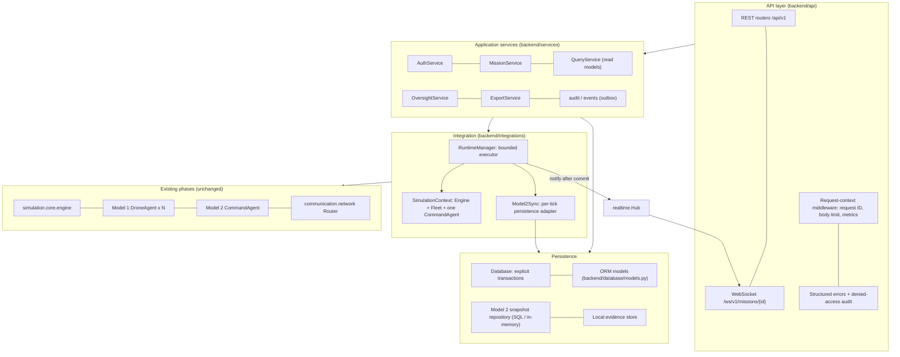
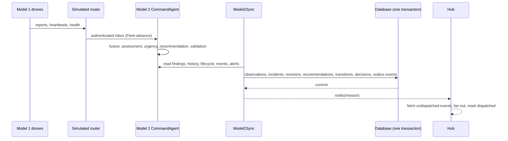
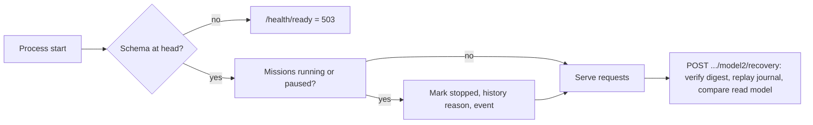

# Backend architecture

The Phase 7 backend is a modular monolith (`backend/`). It persists, secures and serves what the existing simulator, Model 1 fleet and Model 2 command agent produce. It contains **no incident assessment, urgency logic, recommendation logic or safety validation of its own**: those stay in `agents/command_agent` (Model 2) and `agents/drone_agent` (Model 1).

This document consolidates the requested backend architecture, simulation integration, Model 1 integration, Model 2 integration, event architecture, persistent memory, and failure and recovery documents.

## Layers and modules



| Module | Responsibility |
|---|---|
| `backend/application.py` | App factory, lifespan, container wiring. Independent instances for tests. |
| `backend/core/` | Settings (`config.py`), tokens and Argon2id (`security.py`), permission matrix (`permissions.py`), JSON logging with redaction, error types. |
| `backend/database/` | Declarative base, ORM models, engine/session/transaction management, append-only audit DDL. |
| `backend/services/` | Authorization at resource level, missions, read models, oversight, exports, audit and outbox events. |
| `backend/integrations/` | Scenario validation, simulation contexts, the runtime manager and the Model 2 persistence adapter. |
| `backend/persistence/` | Model 2 checkpoint repository and restoration; local content-addressed evidence storage. |
| `backend/realtime/hub.py` | Mission-scoped WebSocket fan-out from the outbox. |
| `backend/cli.py` | Local user creation (first administrator). |

ORM rows never leave services; every response is a Pydantic schema from `backend/schemas.py`. Request schemas forbid unknown fields.

## Application lifecycle

`create_app(settings)` validates settings (a missing or short `SWARM_JWT_SECRET` fails at startup), builds the container and registers routers. Lifespan startup:

1. Reads the Alembic revision. If the schema is not at head it logs an error and `/health/ready` reports 503. It never creates tables.
2. Marks missions left `running` or `paused` by a previous process as `stopped` (see recovery).
3. Starts no simulation.

Shutdown stops each runtime with reason `backend shutdown`, closes WebSockets and disposes the connection pool. There are no free-running background threads: each mission is one asyncio task that steps the simulation in a worker thread.

## Simulation integration

`SimulationContext` (`backend/integrations/simulation_adapter.py`) builds, from a validated `MissionConfig`, the existing `Engine`, a `Fleet` with transport, Phase 5 coordination and one `CommandAgent`. Clients choose only among scenario fixtures in `configs/scenarios/` by name (regex and allow-list, never a path) and whitelisted overrides: agents (1-20), seed, horizon, coordination policy, Model 2 mode and extra outage steps.

`RuntimeManager` (`backend/integrations/runtime.py`):

- Runs at most `SWARM_MAX_CONCURRENT_SIMULATIONS` missions; a duplicate start returns 409.
- Steps one tick per loop iteration (`Fleet.advance`) on a worker thread under the mission lock, then persists the tick, then dispatches events, then sleeps `SWARM_SIMULATION_TICK_DELAY_MS`.
- Mission states: `draft -> running <-> paused -> stopped`, `running -> completed | failed`. Terminal missions cannot restart; create a new mission to rerun. The completion reason records the engine reason (`horizon` or `inactive`, i.e. no active drones).
- Simulation time (`sim_time_ms`, `last_sim_ms`) and server time (`created_at`, `occurred_at`, UTC) are stored separately.
- Deterministic: the same configuration and seed reproduce the same Model 2 outcome (verified in tests and by two identical demonstration runs).

Single-process limitation: runtimes live in one process. Running several uvicorn workers would let each start its own simulations; the duplicate-start guard is per process. Deploy one worker.

## Model 1 integration

The backend does not sit in the Model 1 loop. Drone agents still run their own perception, memory, reasoning and safety gates inside `Fleet.advance`, and Phase 4 peer traffic stays on the simulated router. The backend reads what reached the command endpoint:

| Model 1 output | Persisted as |
|---|---|
| Heartbeat | `agent_reports` (status), `agents.reported_state` |
| AgentHealth (battery, degraded sensors, reported cell) | `agent_reports` (health), latest reported position on `agents` |
| Environmental, hazard and possible-human detections | `observations` + `evidence`, outcome taken from Model 2's own admission event |
| TaskStatus | `tasks.reported_status` |

Out-of-band ingestion (`POST /missions/{id}/observations`, `POST /missions/{id}/agent-health`) uses an agent credential. The reporter identity comes from the credential, never the body; the body cannot carry an incident classification. The report is wrapped in an `Envelope` and passed to the mission's `CommandAgent.consume`, exactly like a transported report. Private Model 1 memory is never read or written.

## Model 2 integration



One `CommandAgent` exists per mission execution, created at start and discarded when the run ends. It is never created per HTTP request. `Model2Sync` copies Model 2's validated outputs after each tick:

- Admitted findings, with outcomes from Model 2 events (`admitted`, `duplicate`, `conflict`, `stale`, ...).
- Each `IncidentUpdate` becomes an `incident_revisions` row (category, report IDs, uncertainties, urgency) and updates `incidents`. Fusion-group membership goes to `incident_evidence`.
- Each `Recommendation` becomes a `recommendations` row; the previous pending version becomes `superseded`.
- Lifecycle transitions go to `incident_transitions`; recommendation status follows (`approved`, `confirmed`, `rejected`, `expired`, `revision_requested`).
- `CommandAlert` messages delivered to the operator endpoint go to `alerts`.

Identifier scoping: the simulator derives incident, recommendation, message and task IDs deterministically from scenario and seed, so they repeat across missions. Backend resource IDs are `uuid5(mission_id, "model2/<id>")`; the original identifier is kept in `model2_id` and used whenever the backend talks to Model 2. (A test running two identical missions caught the collision this prevents.)

### Human decisions

```mermaid
sequenceDiagram
  participant U as Coordinator
  participant API as OversightService
  participant DB as Database
  participant O as Operator channel (simulated)
  participant C as Model 2 validator
  U->>API: POST /recommendations/{id}/approve {version}
  API->>API: identity, permission, idempotency key
  Note over API: hold mission lock
  API->>DB: re-check version, status, deadline; insert decision (submitted) + audit; commit
  API->>O: HumanApproval (Model 2 IDs, expected revision)
  API-->>U: 202 {status: submitted}
  O->>C: delivered next tick
  C->>C: validate_decision (operator, revision, deadline, prior decision)
  C-->>DB: (via Model2Sync) decision accepted or rejected + transition + event
```

The backend refuses outdated versions (409 `stale_version`), expired recommendations and non-pending recommendations before sending. Model 2 remains authoritative: a decision is `submitted` until Model 2's validator accepts or rejects it, and a decision still unprocessed when the run ends becomes `undeliverable`. The decision record is committed before the message is sent; its message ID is predicted deterministically from the operator mailbox and checked after sending. Approval issues no movement command; Model 1 safety gates are unaffected.

Endpoint mapping: approve maps to `approve_review` (or `confirm_rescue_need` when `confirm_rescue_need: true`), reject to `reject`, request-revision to `HumanIncidentReview(correct)`, incident acknowledge to `approve_review` on the pending recommendation, request-review to `prioritize`, resolution-report to `resolve`, close to `close` (only after a resolution report), and mission override to the revision-bound `HumanOverride` (assignment pause, resume or end). Mission pause, resume and stop control simulation execution, which is separate from the override.

## Domain events and outbox

Typed event names are in `backend/services/events.py`. Every event row carries its ID, type, mission, per-mission `sequence`, schema version, source identity, server timestamp, simulation timestamp, correlation ID (run ID or request ID), resource type and ID, and a JSON payload.

- Events are inserted in the same transaction as the state change (transactional outbox). The sequence comes from an atomic `UPDATE mission_runtime ... RETURNING`.
- After commit the hub reads undispatched events, fans them out, then marks them dispatched. A crash between fan-out and marking redelivers them: **at-least-once**, ordered per mission. Exactly-once delivery is not claimed. Consumers de-duplicate by `(mission_id, sequence)`.
- Per-connection queues are bounded; see [WEBSOCKET_PROTOCOL.md](WEBSOCKET_PROTOCOL.md).

## Persistent Model 2 memory

| Information | How it becomes durable |
|---|---|
| Observations, evidence, incidents and revisions, transitions, recommendations and history, alerts, decisions, tasks, hazards, agent reports, outbox events | Continuously: one transaction per tick |
| Model 2 replay journal (`Checkpoint`) and Model 2 read model (`snapshot()`) | Every `SWARM_SNAPSHOT_EVERY_TICKS` ticks and at run end, in `mission_snapshots` with a SHA-256 digest |
| Phase 5 coordination snapshot | Same cadence |
| Router queues, sender sessions, simulator world state | **Not durable** |

`backend/persistence/memory_adapter.py` defines a `SnapshotRepository` protocol with SQL and in-memory implementations. `restore_model2` rejects missing, foreign-schema, digest-mismatched, incomplete or out-of-scope checkpoints, then rebuilds memory through `CommandAgent.restore` (Model 2 replays its own journal with its own validation). `POST /missions/{id}/model2/recovery` restores into a read-only instance and compares it with the stored read model of the same tick. In the demonstration the restored read model matched the persisted one.

## Failure and recovery

| Failure | Behaviour (tested) |
|---|---|
| Database transaction fails during a tick | Adapter cursors and caches are restored; the next tick persists the same data. After 20 consecutive failures the mission ends `failed`. The in-process simulation keeps running meanwhile (`test_database_failure_during_tick_loses_nothing`). |
| Database unreachable | `ServiceUnavailable` (503 `database_unavailable`); `/health/ready` 503; detailed health `degraded`. |
| Model 2 endpoint outage (scenario `outage_steps`) | Model 2 stops consuming, as in Phase 6; events `MODEL_2_UNAVAILABLE`, then `MODEL_2_RECOVERED`, `COMMUNICATION_DEGRADED`, then `COMMUNICATION_RESTORED`. |
| Operator interface unavailable | Simulated operator endpoint queues messages (Phase 4 semantics). Decisions stay `submitted`, then are validated or become `undeliverable`. |
| Duplicate or replayed requests | Observation ID plus content returns the original result. A decision `idempotency_key` returns the original decision; reusing a key for a different action returns 409. |
| Duplicate or out-of-order events | Unique `(mission_id, sequence)`; WebSocket cursor drops already-delivered sequences. |
| Slow WebSocket client | `resync_required`, then close 4008. The client resynchronizes from REST. |
| Process crash or restart | Committed data is intact (verified after an abrupt kill). Missions that were running are marked `stopped` with reason "backend restarted; in-memory simulation state was not durable". Simulations do **not** resume. Model 2 memory is restorable from the latest checkpoint for inspection. |
| Corrupted snapshot | Digest mismatch, so restoration is refused and audited as `failure`. |

Non-idempotent operations are not retried automatically. Durable persistence is never acknowledged before commit: decisions return 202 only after their record commits.


