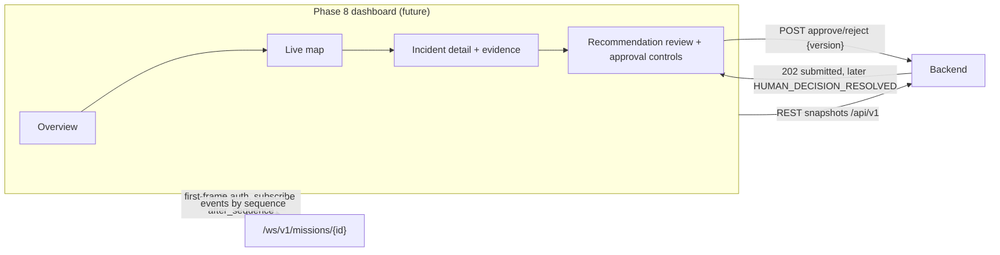

# Phase 8 dashboard integration contracts

Phase 7 provides the contracts below; it does not implement a frontend. Each dashboard view loads a REST snapshot, then follows the mission WebSocket and re-reads the affected resource when an event arrives. Every value shown was reported by an agent, decided by Model 2 or recorded from a human. Nothing in these views is simulator ground truth, and the dashboard must label it accordingly: reported, assessed, stale, unknown.



| Component | Snapshot endpoint(s) | Live topics | Notes |
|---|---|---|---|
| Mission overview | `/missions/{id}`, `/summary`, `/history` | mission, metrics, model2, communication | `model2_state`, `communication_state`, `last_sim_ms` |
| Live simulation map | `/missions/{id}/map` (layers agents, incidents, hazards, stale_observations, sectors, coverage) | agents, incidents, hazards, coverage | Local grid; see schema below |
| Agent status | `/missions/{id}/agents`, `/agents/{id}/health`, `/location-history` | agents | `availability` (coordinator-known: unknown, available, unavailable or stale) differs from `communication` (connected or disconnected); neither means "failed" |
| Incident list and details | `/missions/{id}/incidents`, `/incidents/{id}`, `/history`, `/assessments` | incidents | `freshness_ms`, supporting and conflicting counts, `current_recommendation_id` |
| Evidence viewer | `/incidents/{id}/evidence`, `/observations/{id}/evidence`, `/evidence-objects/{id}/content` | observations | Synthetic artifacts only; content is served as an attachment with `nosniff` |
| Environmental hazards | `/missions/{id}/hazards`, `/environment` | hazards | Reporters, report count, `stale` |
| Recommendation review | `/missions/{id}/review-queue`, `/recommendations/{id}/versions`, `/evidence` | review, recommendations | Show `version` and `remaining_ms`; bind every decision to the displayed version |
| Human approval controls | `POST /recommendations/{id}/approve`, `/reject`, `/request-revision`; incident actions; `/alerts/{id}/acknowledge` | review, alerts | 202 means "recorded and forwarded"; show the Model 2 outcome when it arrives |
| Communication monitoring | `/missions/{id}/metrics` (`live.communication`) | communication | Delivery ratio and pending counts come from the simulated router |
| Search coverage | `/missions/{id}/coverage`, `/sectors`, `/tasks` | coverage | Coverage means reported cells, not verified search |
| Research analytics | `/missions/{id}/exports/operational`, `/exports/research` (researchers) | metrics | Ground truth appears only in research exports |
| System health | `/health/ready`, `/system/health`, `/system/metrics` (administrators) | - | Public probes reveal no details |

## Map schema (local coordinates)

```json
{
  "crs": "swarm-aid:grid", "units": "cell", "width": 12, "height": 10,
  "map_ref": "flood_basic", "sim_time_ms": 3000,
  "layers": [
    {"name": "agents", "description": "...", "features": [
      {"id": "d0", "layer": "agents",
       "location": {"crs": "swarm-aid:grid", "x": 4, "y": 2, "units": "cell", "uncertainty": 0.5, "map_ref": "flood_basic"},
       "properties": {"communication": "connected", "availability": "available", "last_location_ms": 2900, "stale": false}}
    ]}
  ]
}
```

Render cells as a grid with the origin at cell (0, 0). Do not project these coordinates onto geographic basemaps. GeoJSON is reserved for genuine `EPSG:4326` data, which the simulator does not produce.

## Client rules

1. Never infer authority from the UI: the server enforces permissions; hide controls the user's role lacks (see the matrix in [SECURITY.md](SECURITY.md)).
2. Always send the displayed `version` and an `idempotency_key` per user action; handle 409 by reloading and showing what changed.
3. Keep the highest WebSocket `sequence`; on reconnect, subscribe with `after_sequence`; on `resync_required`, reload snapshots.
4. Show simulation time (`*_ms`) and server time (`*_at`) separately.
5. Label every location with its CRS and uncertainty, and every count of reported cells as reported, not verified.
