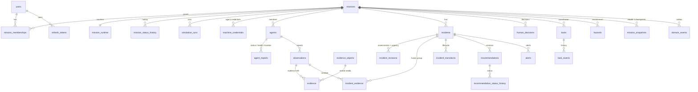

# Database architecture, schema, migrations and setup

This document consolidates the database architecture, schema, migrations, PostgreSQL setup, PostGIS integration and local development documents.

PostgreSQL with PostGIS is the target. SQLite is supported for local development and all automated tests. **In Phase 7 only SQLite was executed; PostgreSQL and PostGIS behaviour is implemented but unverified** (no server was available on the development host).

## Design rules

- SQLAlchemy 2.x typed declarative models in `backend/database/models.py`; naming conventions in `base.py`.
- Every mission-owned table has `mission_id`. Links between mission-owned rows use **composite foreign keys on `(mission_id, id)`**, so the database itself rejects a cross-mission link (tested).
- No delete cascades. Evidence, decisions and audit rows are never removed implicitly.
- `audit_logs` is append-only: triggers reject UPDATE and DELETE on both SQLite and PostgreSQL (tested on SQLite).
- Timestamps are timezone-aware UTC (`UTCDateTime` rejects naive values). Simulation time is stored separately as integer milliseconds.
- Optimistic concurrency: `version` columns (`version_id_col`) on users, missions, incidents and recommendations. A concurrent overwrite raises 409 `stale_version`. Fast-changing runtime counters live in `mission_runtime` so ticks never conflict with user edits.
- Backend resource IDs for Model 2 objects are mission-scoped (`uuid5(mission_id, ...)`), with Model 2's identifier in `model2_id`.

## Entity relationships



## Logical entities and their tables

| Requested logical entities | Table(s) | Notes |
|---|---|---|
| users, roles, user_roles | `users.global_role` | One global role per account; a check constraint lists the roles. |
| mission_memberships | `mission_memberships` | Mission-scoped role (coordinator, operator, researcher, observer). |
| authentication_sessions | `refresh_tokens` | Rotating refresh tokens; SHA-256 fingerprint only; `family_id` for reuse revocation. |
| agent_credentials | `machine_credentials` | Agent (mission-scoped) and service identities; Argon2id secret hash. |
| missions, configuration snapshots, status history, events, simulation_runs | `missions` (validated config JSON), `mission_status_history`, `domain_events`, `simulation_runs` (full scenario and Model 2 settings) | |
| agents, assignments, status/health/location history | `agents`, `agent_reports` (type `status`, `health`, `communication`) | An agent row is the mission assignment. |
| observations, evidence_references, observation_sources | `observations` (reporter, provenance, outcome, source), `evidence` | |
| evidence_groups, members, conflicts | `incident_evidence` (role supporting or conflicting) | One Model 2 fusion group per incident; `/evidence-groups/{id}` uses the incident ID. Model 2's conflict list is in the read-model snapshot. |
| incidents, incident_evidence, status history, assessments, urgency history | `incidents`, `incident_evidence`, `incident_transitions`, `incident_revisions` | Each revision row records the urgency level and reason. |
| recommendations, versions, evidence, status history | `recommendations` (one row per version = incident revision; `evidence_ids` JSON), `recommendation_status_history` | |
| human_review_requests, human_decisions, override events, resolution reports | `human_decisions` (kind `approval`, `incident_review`, `override`, `alert_acknowledgement`), `alerts`, `HUMAN_REVIEW_REQUESTED` events | Review requests are pending recommendations. |
| tasks, assignments, status history | `tasks` (coordinator state and agent-reported status), `task_events` (ordered by `ordinal`) | |
| search_sectors, coverage_snapshots, coordination_conflicts | Computed read models plus `mission_snapshots(kind=coordination)` | Sectors are recomputed from public mission geometry. |
| environmental_hazards, hazard_observations, environmental snapshots | `hazards` (aggregated per cell and label, reporters), hazard observations in `observations`, Model 2 world model in `mission_snapshots(kind=model2_read_model)` | |
| communication_events | Run `operational_metrics.communication_full`, plus `COMMUNICATION_*` events | **Deferred:** per-packet router events are not persisted. |
| command_records, domain_events, outbox_events | `human_decisions` (with operator-channel `message_id`), `domain_events` (also the outbox, via `dispatched_at`) | |
| audit_logs | `audit_logs` | Append-only. |
| system_health_snapshots | Not stored | **Deferred:** health is computed live. |

Total: 27 application tables plus `alembic_version`.

## Migrations

```powershell
$env:SWARM_DATABASE_URL = "sqlite:///./runs/backend/swarm_aid.db"   # or a PostgreSQL URL
.\.venv\Scripts\python.exe -m alembic upgrade head
.\.venv\Scripts\python.exe -m alembic current
.\.venv\Scripts\python.exe -m alembic history
.\.venv\Scripts\python.exe -m alembic downgrade base    # development databases only
```

`migrations/env.py` reads the URL from `-x url=...`, `SWARM_DATABASE_URL` or a SQLite default; it never needs the JWT secret. Revision `0001` creates all tables, indexes and constraints, the append-only audit triggers, and on PostgreSQL only: `CREATE EXTENSION postgis`, generated `geom` columns and GiST indexes. Tests verify upgrade, downgrade to an empty schema, re-upgrade, and a no-op upgrade over existing data. Future changes must be new revisions; no normal update requires a destructive reset. Never run `downgrade` against a database whose data matters without authorization.

## Geospatial model and PostGIS

Simulator coordinates are local grid cells, not latitude and longitude. Every location stores `x`, `y`, `crs`, `uncertainty` (`swarm-aid:grid`, unit cell, uncertainty ±0.5 cell for cell-granular reports) and, for observations, a `map_ref` (scenario ID). API `Location` objects add `units`. `EPSG:4326` is accepted only for valid longitude and latitude; the simulator never produces it. GeoJSON is not used for local coordinates; see the map schema in [DASHBOARD_INTEGRATION.md](DASHBOARD_INTEGRATION.md).

| Capability | SQLite | PostgreSQL + PostGIS |
|---|---|---|
| Store and read locations | Yes (tested) | Same columns |
| Bounding-box filter (`bbox=x0,y0,x1,y1`) | Portable `BETWEEN` (tested) | Same SQL |
| Geometry column | None | `geom geometry(Point, 0)` generated from x/y on observations, incidents, hazards, agents |
| Spatial index | B-tree on `(mission_id, x, y)` | GiST on `geom` |
| Distance or containment (`ST_DWithin`, `ST_Contains`) | Not available | Available; exercised only by the skipped PostGIS test |
| Geographic (SRID 4326) storage | Not implemented | **Deferred:** would need a separate `geography(Point, 4326)` column |

No navigation or safe-route generation is implemented.

## PostgreSQL setup (unverified in Phase 7)

Option A, Docker (optional): set `POSTGRES_PASSWORD` in `.env`, then run `docker compose up -d`, `docker compose ps` and `docker compose logs db`. The first start downloads the `postgis/postgis:16-3.4` image (about 400 MB). The port binds to 127.0.0.1 only.

Option B, native: install PostgreSQL 16 and the PostGIS bundle (Stack Builder on Windows), then:

```sql
CREATE ROLE swarm_aid LOGIN PASSWORD 'choose-a-local-password';
CREATE DATABASE swarm_aid OWNER swarm_aid;
\c swarm_aid
CREATE EXTENSION postgis;   -- requires a superuser once
```

Then set `SWARM_DATABASE_URL=postgresql+psycopg://swarm_aid:<password>@127.0.0.1:5432/swarm_aid` and run `alembic upgrade head`. To run the PostGIS test, set `SWARM_TEST_POSTGRES_URL` to a disposable database and run `pytest tests/backend_api/test_exports_health_geo.py`.

## Local development (SQLite)

File databases use WAL and `synchronous=NORMAL`: readers proceed during tick writes, and committed data survives a process crash, but the most recent transactions can be lost on an OS crash or power loss. Tests keep SQLite files in the system temp directory, because on the development host the repository drive made each journaled write about 25 times slower.
