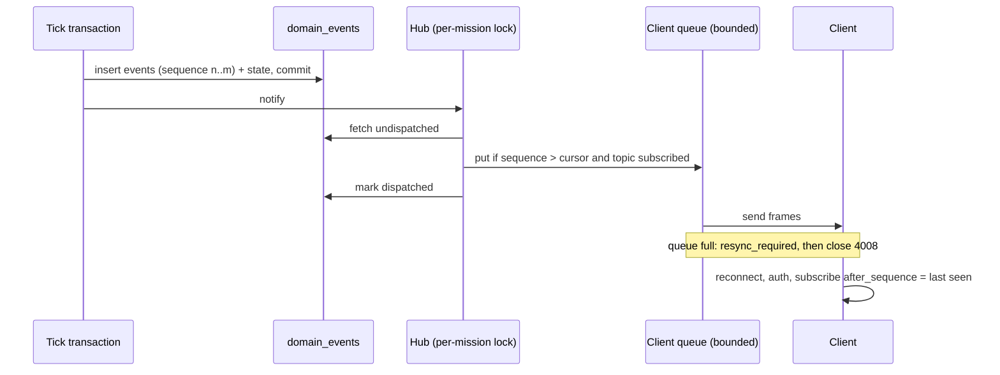

# WebSocket protocol

Endpoint: `ws://127.0.0.1:8000/ws/v1/missions/{mission_id}`. One connection streams one mission's outbox events.

## Authentication

Browsers cannot set an `Authorization` header on a WebSocket, and query-string tokens leak into logs and history. The client therefore sends the human access token in the **first frame**, within `SWARM_WEBSOCKET_AUTH_TIMEOUT_SECONDS` (default 5 s):

```json
{"type": "auth", "token": "<access token>"}
```

The server verifies the token (human audience, access purpose, active account) and requires `mission.read` on the mission. Close codes: 4401 unauthenticated or invalid token, 4403 no access or unknown mission, 4029 connection limit, 4400 malformed frame, 4008 too slow (resynchronize), 1001 server shutdown. Authorization is re-checked at every heartbeat, so expired tokens and revoked memberships end the stream with 4403. Use `wss://` behind TLS outside local development.

## Frames

| Direction | Frame | Meaning |
|---|---|---|
| server | `{"type":"welcome","mission_id","last_sequence","topics","heartbeat_seconds"}` | Live events after `last_sequence` follow. |
| client | `{"type":"subscribe","topics":[...],"after_sequence":n}` | Set topics; with `after_sequence`, replay later events first (up to 1000). |
| server | `{"type":"subscribed","topics":[...]}` | Acknowledges a subscription. |
| server | `{"type":"event","event":{...}}` | One domain event (schema below), strictly increasing `sequence`. |
| server | `{"type":"heartbeat","last_sequence":n}` | Every `SWARM_WEBSOCKET_HEARTBEAT_SECONDS` (default 15 s). |
| client / server | `{"type":"ping"}` / `{"type":"pong"}` | Liveness check from the client. |
| server | `{"type":"resync_required","last_delivered_sequence":n}`, then close 4008 | Client queue overflowed; resynchronize over REST. |
| server | `{"type":"error","code":...}` | Unknown frame type or invalid topics. |

Topics: `mission`, `agents`, `observations`, `incidents`, `recommendations`, `review`, `alerts`, `hazards`, `coverage`, `communication`, `model2`, `metrics` (default: all).

### Event schema (version 1)

```json
{
  "id": "uuid", "mission_id": "uuid", "sequence": 42, "event_type": "INCIDENT_UPDATED",
  "schema_version": "1", "source": "model2", "occurred_at": "2026-11-24T10:00:00Z",
  "sim_time_ms": 1800, "correlation_id": "run or request id",
  "resource_type": "incident", "resource_id": "uuid", "payload": {}
}
```

| Topic | Event types |
|---|---|
| mission | MISSION_CREATED, MISSION_STARTED, MISSION_PAUSED, MISSION_RESUMED, MISSION_STOPPED, MISSION_COMPLETED |
| agents | AGENT_REGISTERED, AGENT_STATUS_UPDATED, AGENT_HEALTH_UPDATED |
| observations | OBSERVATION_RECEIVED |
| incidents | INCIDENT_CREATED, INCIDENT_UPDATED, INCIDENT_ESCALATED, EVIDENCE_GROUP_UPDATED |
| recommendations | RECOMMENDATION_CREATED, RECOMMENDATION_REVISED, RECOMMENDATION_APPROVED, RECOMMENDATION_REJECTED |
| review | HUMAN_REVIEW_REQUESTED, HUMAN_DECISION_RESOLVED, HUMAN_OVERRIDE_RECORDED |
| alerts | ALERT_RAISED |
| hazards | HAZARD_REPORTED |
| coverage | TASK_UPDATED |
| communication | COMMUNICATION_DEGRADED, COMMUNICATION_RESTORED |
| model2 | MODEL_2_UNAVAILABLE, MODEL_2_RECOVERED |
| metrics | METRICS_UPDATED (every 10 ticks and at run end) |

## Delivery and reconnection



Guarantees: per-mission ordering by `sequence`; at-least-once delivery while connected (redelivery is possible after a crash between fan-out and marking); no cross-mission delivery. Clients must de-duplicate by sequence. Live fan-out and backlog replay share the per-mission lock, so a reconnecting client receives neither gaps nor reordering.

Reconnection workflow: keep the highest `sequence` seen; reconnect; authenticate; send `subscribe` with `after_sequence`. If more than 1000 events were missed (`resync_required`), load REST snapshots (`/summary`, `/incidents`, `/review-queue`, `/map`) and page `GET /missions/{id}/events?after_sequence=n`.

Measured on the development host: 50 concurrent authenticated connections all succeeded (median connect plus auth 16.7 ms). Delivery latency appears in [BACKEND_PERFORMANCE_METRICS.md](../research/BACKEND_PERFORMANCE_METRICS.md). Slow-client handling is unit-tested on the hub, because the test transport applies no backpressure.
