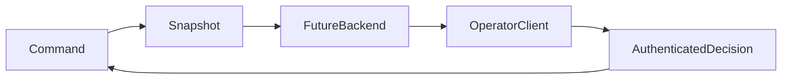

# Backend integration boundary

A later backend can consume immutable incident updates, persist decision references, and expose copied read models. It will need durable transactions, authenticated users, replay protection and reliable reconciliation after a process crash. The trusted application checkpoint covers command state. It omits transport queues, sender sessions and the external coordination registry.

