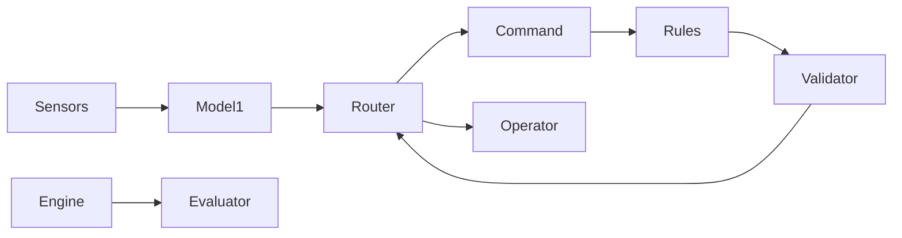

# Command agent architecture

Fleet owns one CommandAgent per mission. The router delivers to the command endpoint. Fleet passes only admitted envelopes, a principal bound by the router and mission time into the reasoning cycle. Command has no Engine handle. Its outputs travel through the operator channel. The evaluator separately observes person identities at capture time.

