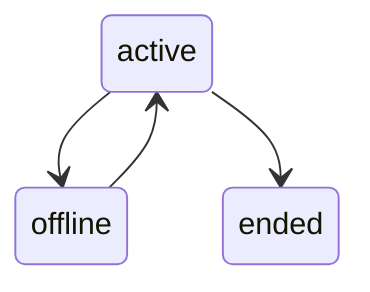

# Failure and recovery

When the simulated command endpoint disconnects, the command cursor stops. At reconnection the router applies session checks and deadlines. Command consumes newly admitted messages and reviews freshness at the current tick. The cursor advances once for each processed batch. The event log records offline and recovered. Provider exceptions reject the assessment; no proposal is published for that attempt. Restart-safe delivery is beyond this in-memory adapter.

