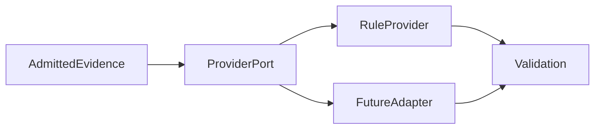

# Future provider integration

CommandAgent accepts incident assessment, recommendation, urgency and finding-store dependencies. Replacement providers receive typed reports and a previous incident. The existing provenance and authorization checks apply. Offline evaluation can compare a provider against the included deterministic conditions with identical configuration and seeds. Replaying an application checkpoint requires equivalent providers.

