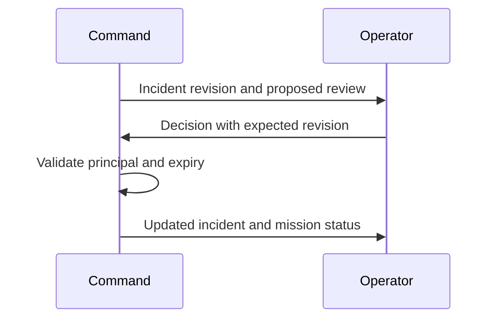

# Operator oversight

The simulated operator receives typed alerts. HumanApproval binds its decision to the current incident revision and recommendation. HumanIncidentReview supports corrections, priorities, reported resolution and closure. The scripted experiment alternates approve_review and reject once per incident. It never confirms rescue need. The ordinary CLI requires an explicit operator input. A revision-bound HumanOverride addressed to command can suspend, end or resume Phase 5 assignments. Drone-specific overrides continue through the existing operator-to-drone channel.

