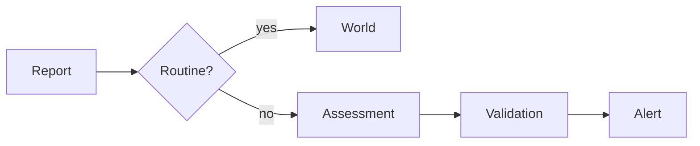

# Incident assessment

Routine environmental observations update the world model. Hazard and sighting reports can open incidents. Direct mode instead sends each original finding to the operator. Rules mode opens separate incidents. Fusion revises a related incident while recent supporting reports remain. The independent checks reject unsupported report references, mismatched incident revisions and provider-issued human confirmation.

