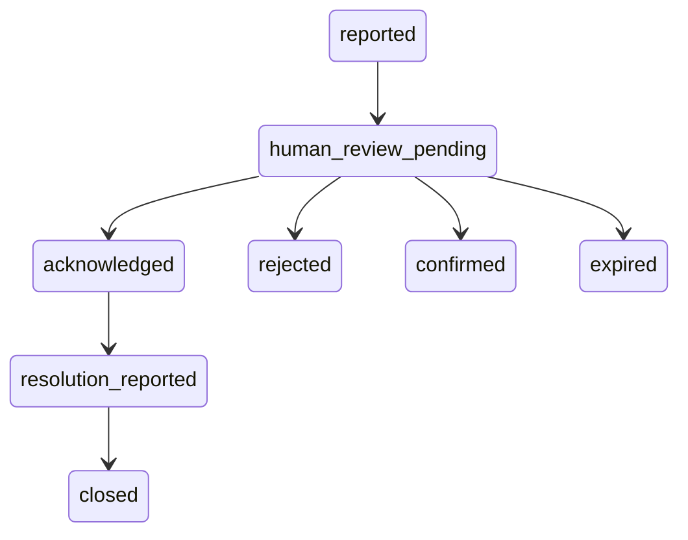

# Incident lifecycle

Incident identity remains stable across accepted revisions within an association window. The lifecycle records actor, previous and current state, time, revision and source reference. Human correction and prioritization revise the record. An authenticated resolution report must precede closure. A new observation after closure opens a new review record. Closing a synthetic incident makes no assertion of physical rescue.

