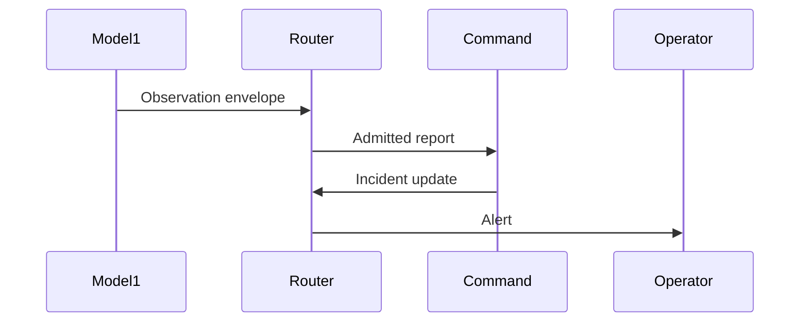

# Model 1 integration

Model 1 sends the same sensor findings, status and evidence references as in earlier phases. Registering the optional command consumer leaves sensor inputs, local memory and action selection with each drone. A command outage exercises existing link and lease behavior. Routing selects a session independently of the payload.

