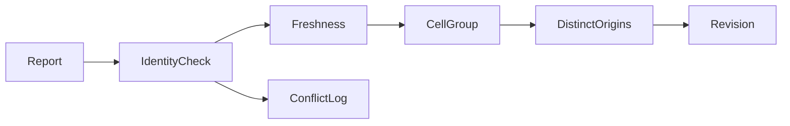

# Multi-agent evidence fusion

The fusion key consists of finding kind, label and reported grid cell. A locationless report forms its own group. Only fresh reports enter the next revision. Corroborating reports received during a pending review are held and enter the revision after the decision or expiry; the snapshot lists them under held_reports. The threshold counts distinct original evidence origins. Recommendation evidence IDs are deduplicated. Exact cell matching can merge unrelated people or split a moving person's reports. The calculation does not calibrate a probability of rescue need.

