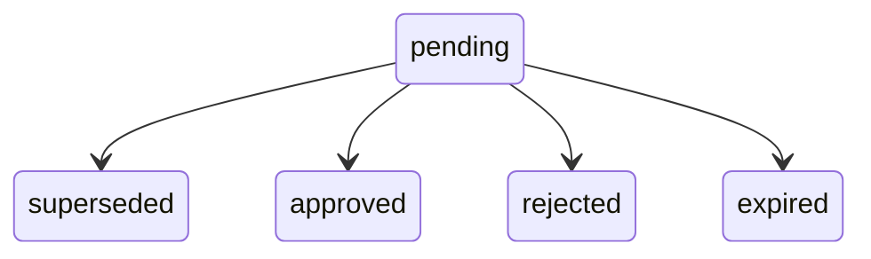

# Recommendation review

New evidence can generate a new incident revision and deterministic recommendation ID. While a recommendation awaits review and has not expired, a report that leaves the category and urgency level unchanged is held as corroboration instead of superseding the revision under review. Held reports join the next revision after the operator decides or the recommendation expires. A category or urgency change revises immediately. The earlier recommendation stays in bounded history. Operator decisions must match the current revision and current recommendation. Expired recommendations leave the review queue. An application-level rejection event records stale or mismatched decisions; router receipt only records delivery.

