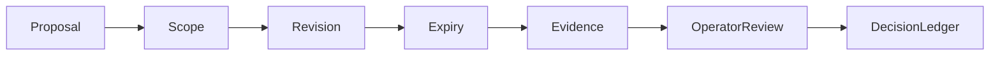

# Safety and authorization

The independent decision validator checks operator identity, current recommendation, incident revision, time and previous disposition. A hazard-only record cannot receive a human-sighting confirmation. A provider may return a proposal but cannot access router controls through its interface. Modified findings and actor-provided claims do not convey operator authority. The transport and providers operate in a trusted Python process.

