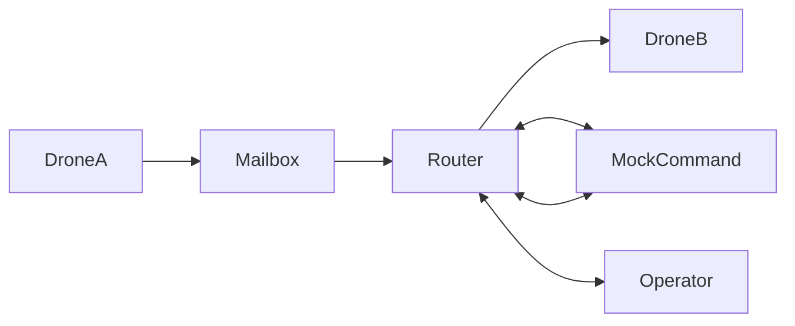
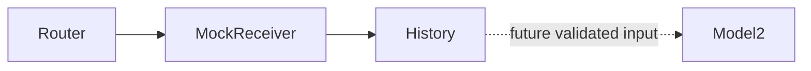

# COMMUNICATION IMPLEMENTATION

Enable --communication to run Model 1 with transport injection. The composition root registers the drones, mock command receiver and operator endpoint, then binds each mailbox to its own sender identity. Each tick samples link availability, advances pending attempts, processes inboxes and runs the agents. Peer evidence enters DroneAgent.receive. The command and human receivers retain validated envelope history for inspection. Phase 2 report-hook traffic is disabled for this mode to avoid a second transmission path.

