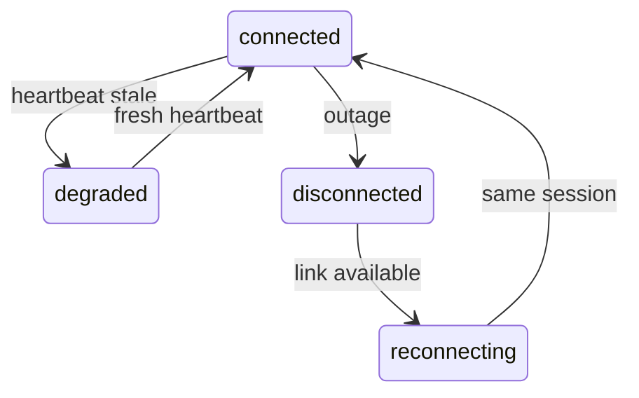
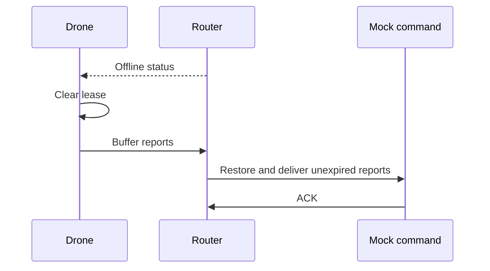

# CONNECTION RECOVERY

Availability sampling distinguishes simulated link silence from agent health. Heartbeat age can mark an endpoint degraded. The drone also checks the age of acknowledged heartbeat creation time. At loss the adapter clears cached authority, records a lifecycle hold when applicable and supplies the local offline signal to the safety controller. Incoming valid retained packets may be processed when the link reopens. Expired commands cannot execute. Restarting a process requires a fresh mission session; persistent cursor reconciliation remains future work.

