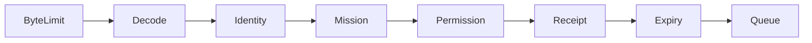

# MESSAGE PROTOCOL GUIDE

Envelope JSON carries origin, mission, session, destination, sequence, evidence lineage, priority, timestamps, correlation and expiry. Pydantic's payload discriminator is the schema registry. submit checks byte length before decoding. Existing v1.0 records retain their wire shape. MissionUpdate is a v1.1 addition for command-to-human status. Its revision, active/paused/ended status and summary are required. A v1.0 wrapper rejects it.

Registration ACK uses Acknowledgement. Heartbeat carries operational status. AgentHealth carries sensor and availability information. IncidentUpdate carries an incident alert and optional recommendation. EvidenceReference addressed to human_review requests inspection. HumanApproval.decision distinguishes rejection, review approval and explicit confirmation. TaskStatus carries action outcomes. ErrorReport supports application errors; transport delivery failures are structured router events. Connection loss/restoration have separate endpoint events and existing wire payloads.

