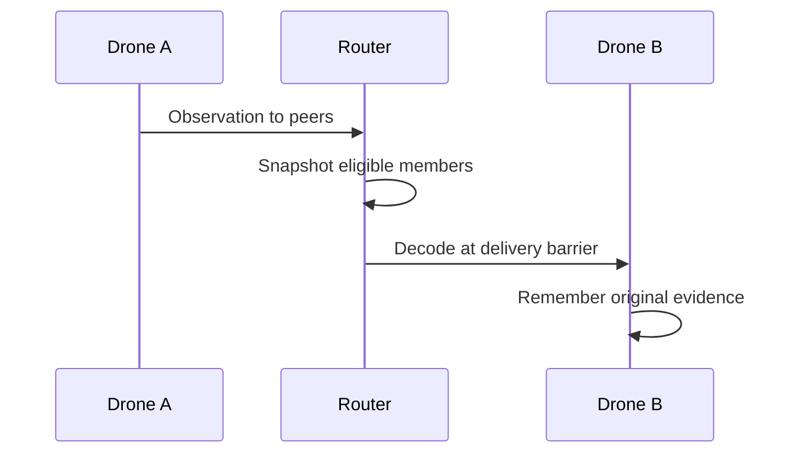
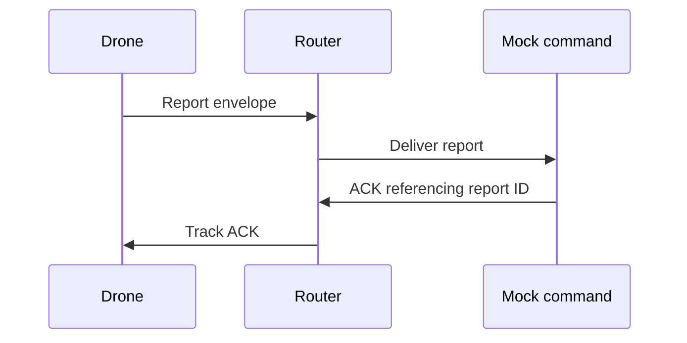

# TRANSPORT ARCHITECTURE

Router owns a mission and a single simulation clock. Its scoped SimulatedPort implements async send and nonblocking receive (QueueEmpty when empty). The synchronous simulator uses the same submit path through a bound callback. Route eligibility is injected into the transport. Only the trusted adapter uses simulated positions. Each delivered object is reconstructed from immutable JSON bytes. Consumers cannot obtain another agent's memory through a packet.

