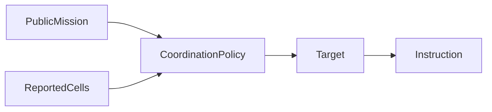

# Baseline policies

Independent uses stationary Model 1 without survey assignments. Fixed sector cycles through configured cells, or deterministic contiguous partitions of column-major grid order. Shared information enables peer delivery and excludes previously reported cells from each sector. Command issues leases every assignment_ticks ticks. Shared target selection uses the command endpoint?s admitted reports. The current comparison changes both peer traffic and target selection.

