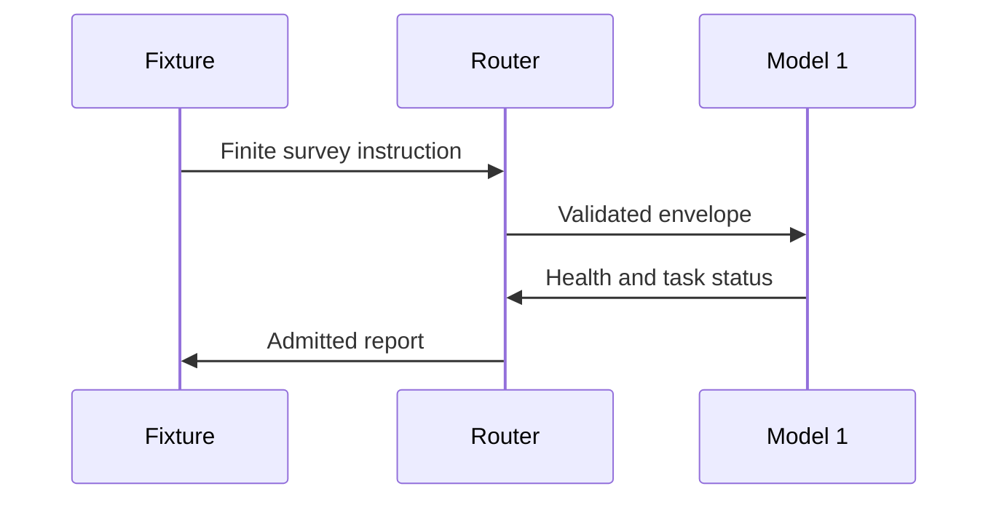

# Communication integration

Survey assignments use existing MissionInstruction, TaskStatus and AgentHealth envelopes. Peer broadcasts resolve through the configured range and partition. Fixed-sector and independent comparisons disable peer links while retaining the command channel. Session binding, queue bounds, expiry, retransmission and receipt accounting remain router responsibilities.

