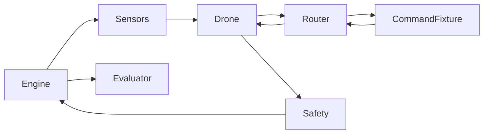

# Cooperative coordination architecture

Fleet constructs a finite mission, a replaceable target policy, independent Model 1 agents and the Phase 4 network. The mock assignment fixture reads the public map dimensions, restrictions, roster and admitted command reports. Only the evaluator reads complete coverage and person IDs.

