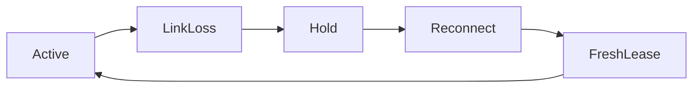

# Failure handling

Transport faults may delay a valid instruction beyond its exclusive deadline. Server loss suspends assignment generation. The drone recovery barrier requires fresh authority and the scheduler can issue a new lease at the next assignment interval. The simulator retains ambiguous status for review.

