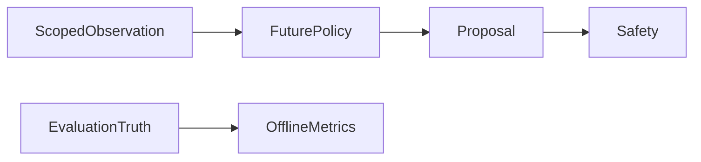

# Future learning-policy integration

RescueEnv exposes four local integers per agent: measured x and y, battery percentage and local possible-human reading count. Missing position is encoded as -1. The ten discrete actions follow Move. Agent departure terminates; the finite horizon truncates. RewardProvider is injectable and the default zero reward is for API testing. The PettingZoo action path is separate from the leased Model 1 baseline. A learning comparison needs an explicit shared observation contract and action authorization adapter.

