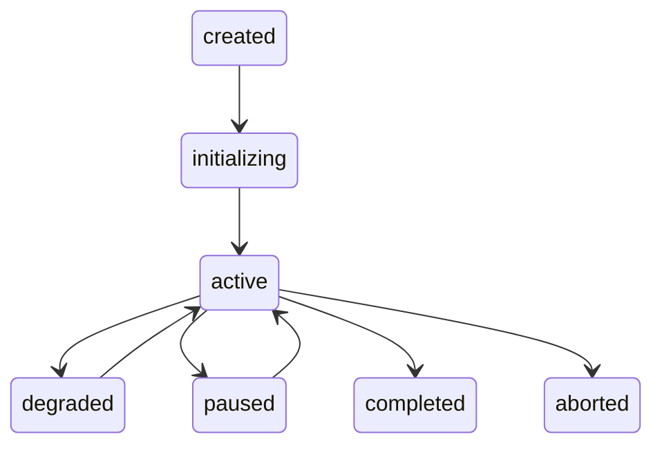

# Mission management

The frozen MissionContext records the mission UUID, public geometry, disaster, roster, objective, constraints, time limit and version. The command fixture timestamps lifecycle changes in mission milliseconds. A completed episode means the simulator stopped. A sighting retains its original uncertainty.

