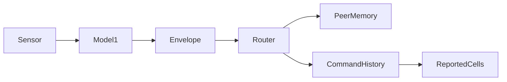

# Shared environmental knowledge

Each Model 1 memory retains admitted observations under their original IDs and TTL. Command keeps its own episode history and a cumulative set of reported cells. A cumulative cell marks historical observation for the search baseline. The full envelopes in command history carry versions, sender, category and evidence. Symbolic cell precision has no calibrated error distribution.

Command retains an observation without a location for evidence review. Only located reports can extend reported-cell coverage. A conflicting reuse of an existing observation ID records a conflict and preserves the first observation and its spatial interpretation.
