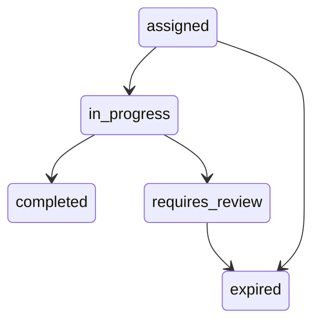

# Task lifecycle

A survey lease binds one member, mission, target and exclusive deadline. The fixture records assignment on issue. Receipt of an active task report starts progress. Subsequent measured presence at the target supplies a completion reference. This criterion measures arrival. Late updates and unauthorized changes enter the conflict log. Deadlines resolve outstanding tasks even at the horizon.

