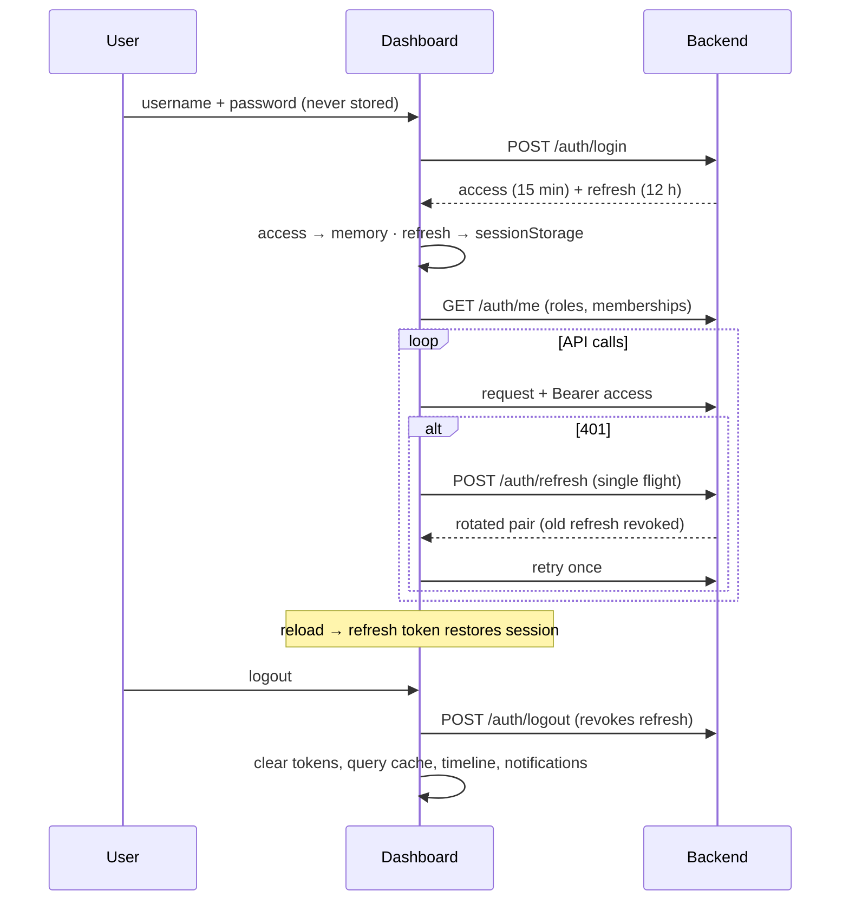

# Phase 8 dashboard: backend integration, contracts, authentication and real-time events

## Endpoint inventory (verified against the running backend, 76 OpenAPI paths + 3 added)

All paths are under `/api/v1` unless noted. "Used by" lists the dashboard views. Every response
is validated with the Zod schema named in `src/contracts/api.ts`.

| Area | Endpoint | Schema | Used by |
|---|---|---|---|
| Auth | `POST /auth/login`, `POST /auth/refresh`, `POST /auth/logout`, `GET /auth/me` | `TokenResponseSchema`, `MeSchema` | sign-in, session restore, refresh rotation, logout |
| Users | `GET /users` | `pageOf(UserSchema)` | e2e setup (memberships); no admin UI in Phase 8 |
| Catalog | `GET /scenarios` *(added in Phase 8)* | `ScenarioInfoSchema[]` | create-mission form |
| Catalog | `GET /experiments`, `GET /experiments/{id}` *(added)* | `ExperimentInfoSchema`, `ExperimentDetailSchema` | experiment results |
| Missions | `GET/POST /missions`, `GET /missions/{id}` | `MissionSchema` | missions, layout, top bar |
| Lifecycle | `POST /missions/{id}/start` `/pause` `/resume` `/stop` | `MissionSchema` | lifecycle controls |
| Missions | `GET /missions/{id}/summary` `/history` `/metrics` `/events` `/audit` `/snapshots` | `MissionSummarySchema`, `StatusHistorySchema`, `MissionMetricsSchema`, `EventSchema`, `AuditSchema`, `SnapshotSchema` | overview, analytics, Model 2, events |
| Members | `POST /missions/{id}/members` | `MembershipSchema` | e2e setup only |
| Exports | `GET /missions/{id}/exports/{operational,research}?format=json,csv` | text | analytics exports |
| Agents | `GET /missions/{id}/agents`; `GET /agents/{id}` `/status` `/health` `/location-history` `/observations` | `AgentSchema`, `AgentReportSchema` | fleet, agent detail, map links |
| Observations | `GET /missions/{id}/observations`, `GET /observations/{id}`, `/observations/{id}/evidence` | `ObservationSchema`, `EvidenceSchema` | observation and evidence centers |
| Evidence | `GET /evidence-groups/{id}`, `GET /evidence-objects/{id}`, `/content` | `EvidenceGroupSchema`, `EvidenceObjectSchema`, Blob | evidence center, incidents, Model 2 |
| Incidents | `GET /missions/{id}/incidents`, `GET /incidents/{id}` `/history` `/assessments` | `IncidentSchema`, `IncidentTransitionSchema`, `IncidentRevisionSchema` | incidents |
| Incident actions | `POST /incidents/{id}/acknowledge` `/request-review` `/resolution-report` `/close`; `POST /missions/{id}/human-feedback` | `DecisionSchema` | incident workspace |
| Recommendations | `GET /missions/{id}/recommendations`, `GET /recommendations/{id}` `/versions` `/history` `/evidence` | `RecommendationSchema`, `RecommendationStatusSchema` | recommendation center |
| Decisions | `POST /recommendations/{id}/approve` (`confirm_rescue_need`), `/reject`, `/request-revision` | `DecisionSchema` | review, recommendation detail |
| Oversight | `GET /missions/{id}/review-queue` `/alerts` `/human-decisions`; `POST /alerts/{id}/acknowledge`; `POST /missions/{id}/override` | `ReviewItemSchema`, `AlertSchema`, `DecisionSchema` | review |
| Coordination | `GET /missions/{id}/tasks` `/sectors` `/coverage` `/coordination-conflicts`; `GET /tasks/{id}/history` | `TaskSchema`, `SectorSchema`, `CoverageSchema`, `ConflictSchema`, `TaskEventSchema` | coordination, map |
| Environment | `GET /missions/{id}/environment` `/hazards` | `EnvironmentSchema`, `HazardSchema` | environment |
| Map | `GET /missions/{id}/map` | `MapSchema` | overview, map, environment |
| Health | `GET /health/live` `/health/ready` (root); `GET /system/health` `/system/metrics` | `SystemHealthSchema`, `SystemMetricsSchema` | top bar probe, system health |
| Real time | `WS /ws/v1/missions/{id}` | `EventSchema` per frame | mission stream |

Not used by the UI: `PATCH /missions/{id}`, `/agent-credentials`, `/model2/recovery`, agent
ingestion endpoints, `GET /tasks/{id}`, `/hazards/{id}`, `/map/layers`, `GET /audit`,
`POST /auth/machine-token`, user creation and deactivation.

### Capability gaps found and how they were handled

| Need | Finding | Resolution |
|---|---|---|
| Scenario list for mission creation | No endpoint | Added read-only `GET /scenarios` (configuration fields only) and a regression test |
| Phase 5/6 experiment comparison | Results existed only as files under `runs/` | Added read-only `GET /experiments[/{id}]` (researcher/administrator) and a regression test |
| Alembic used a different database from the server | `migrations/env.py` ignored `.env` | `configured_database_url()` uses the same precedence as the backend settings; regression test added |
| Hazard severity | Not reported by the backend | Shown as "not reported"; never inferred |
| Battery | Reported by Model 1 health; may be absent | Shown only when reported |
| Per-link peer communication state | Not exposed | Peer links drawn as "unknown" |
| Model 2 unavailability | Emitted when the simulated command endpoint is down (`flood_server_unavailable`, `flood_outage`, or `outage_steps`); the API `model2_state` is `unavailable` meanwhile (agent state `offline`) | Verified against the real backend in Phase 9 (`tests/e2e/connected/integration.spec.ts`, `scripts/system_demo.py`). The Phase 8 statement that it could not occur was wrong |
| HttpOnly cookie sessions | Backend issues bearer tokens in JSON | Bearer design kept; see Authentication |

## Data contracts, freshness and uncertainty

- Nullable fields stay nullable. Unknown confidence renders "unknown", not 0%. A missing
  location renders "not reported", never (0,0).
- Simulation time (`T+mm:ss.s`) and wall-clock time are always formatted separately.
- Freshness uses the backend window (`FRESHNESS_MS = 1500` in `backend/services/queries.py`)
  through the backend's `stale` flags. A **provisional** client threshold of 20 s marks the
  browser's copy as stale when no server update has arrived (`CLIENT_STALE_AFTER_MS`).
- Agent condition is nominal, degraded, stale, unavailable or unknown. A missing heartbeat is
  "stale" or "unknown", never "failed".
- On a schema mismatch the request fails with a `schema` error showing the code and request
  ID; in development the console lists the mismatched paths.

## Transport

`ApiClient` (`src/services/api/client.ts`):

- Base URL comes from `VITE_API_BASE_URL`, defaulting to same-origin. The Vite dev and
  preview servers proxy `/api`, `/health` and `/ws` to `SWARM_BACKEND_URL`, so backend CORS
  stays closed.
- It sends `Authorization: Bearer` with the in-memory access token and an `X-Request-ID`
  correlation header; the backend echoes it and the UI shows it in error states.
- Timeout defaults to 15 s (`VITE_API_TIMEOUT_MS`). Caller cancellation goes through
  `AbortSignal`, and TanStack Query cancels requests for unmounted views.
- Structured errors (`ApiError.kind`) cover network, timeout, aborted, unauthenticated,
  forbidden, not_found, conflict, validation, rate_limited, server, schema and unavailable.
- Mutations never retry. Consequential decisions send an `idempotency_key`, created once per
  dialog and reused on resubmission, so a duplicate submission returns the original decision.

## Authentication and sessions



- **Storage trade-off:** the backend has no HttpOnly cookie mode. The refresh token sits in
  tab-scoped `sessionStorage` so a reload can recover the session; any script running in the
  page could read it. Mitigations: no HTML injection (lint rule), strict CSP on the preview
  and production server, no third-party scripts, and refresh rotation with reuse detection
  (verified: a reused refresh token returns 401).
- If refresh fails, the session expires: caches are cleared and the sign-in page explains
  why. Repeated sign-in failures show the backend's 429 rate-limit message.
- After mission creation and on entering a mission, the dashboard re-reads `/auth/me` so new
  memberships (for example the creator's coordinator role) are reflected without signing out.
  A defect found by the connected e2e suite.

### Roles

Backend identifiers: global `administrator | coordinator | operator | researcher | observer`;
mission `coordinator | operator | researcher | observer`. `src/lib/permissions.ts` mirrors
`backend/core/permissions.py` and unit tests pin the matrix. Administrators can read missions
but **cannot decide** without a mission role, which matches the backend. Controls the user
lacks permission for are disabled with an explanation. They are not hidden security: the
connected e2e suite confirms the backend returns 403 to an observer and 404 for another
mission's direct URL.

## WebSocket integration

```mermaid
sequenceDiagram
  participant D as Dashboard (missionStream)
  participant H as Backend hub
  D->>H: connect /ws/v1/missions/{id} (no token in URL)
  D->>H: {"type":"auth","token":…}
  H-->>D: welcome {last_sequence, heartbeat_seconds}
  D->>H: subscribe {after_sequence: lastApplied}
  H-->>D: backlog + live events (ordered by sequence)
  H-->>D: heartbeat {last_sequence}
  Note over D: EventBuffer: drop duplicates, hold out-of-order,<br/>gap → resync from GET /events?after_sequence
  alt close 4401
    D->>D: refresh token once, reconnect
  else close 4403
    D->>D: stop, status "failed"
  else close 4008 / resync_required
    D->>D: invalidate mission caches, reconnect from cursor
  else network drop
    D->>D: backoff 0.5–30 s with jitter; after 3 failures poll REST events every 3 s
  end
```

- There is one subscription per selected mission, opened by `MissionLayout` and closed on
  mission change, mode change or logout.
- Events whose `mission_id` differs from the selected mission are discarded.
- The live timeline holds 400 events; notifications hold 100, deduplicated by event type and
  resource.
- Silence longer than 2.5× the heartbeat interval counts as a dead connection.
- Status shows in the top bar ("Live events") and in a reconnect banner.

## Failure handling

| Failure | Behaviour |
|---|---|
| Backend unreachable / not ready | Top-bar status and red banner; last-known data shown with a stale banner; retry; explicit option to switch to synthetic |
| Database not ready | `/health/ready` 503 → "not ready" banner |
| Session expired | Caches cleared, sign-in with explanation |
| 403 / cross-mission | Explicit "not permitted" / "Mission not found" state |
| Invalid schema | Error state with code and request ID; data not rendered |
| Missing evidence media | "No stored media for this reference"; nothing fetched by URL |
| Invalid coordinates | Not drawn; counted in the map note; still listed |
| Stale recommendation version | 409 `stale_version` blocks submission until the updated version is loaded |
| Duplicate submission | Same idempotency key returns the original decision |
| WebSocket disconnect | Backoff, REST polling fallback, resync from cursor |
| Mission switch / reload | Stream and timeline reset per mission; session restored from refresh token |
| Render error | Per-route error boundary; the rest of the shell stays usable |

Consequential operations are never restarted automatically.
