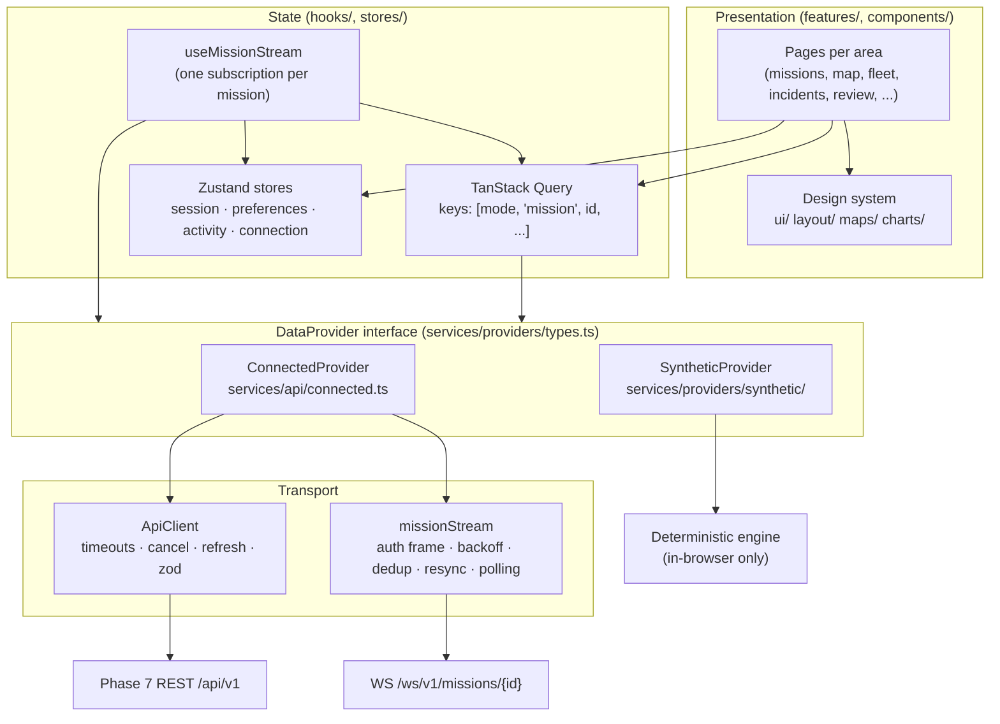
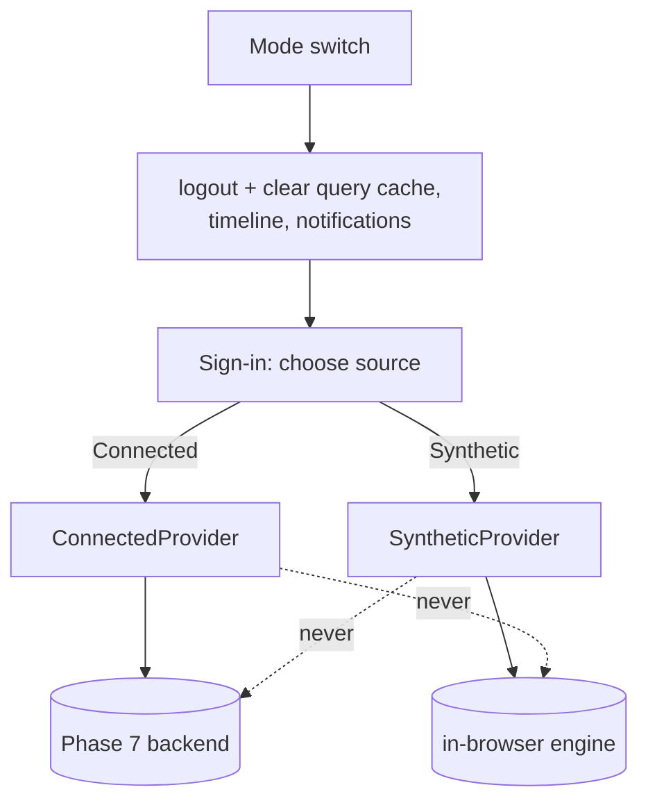
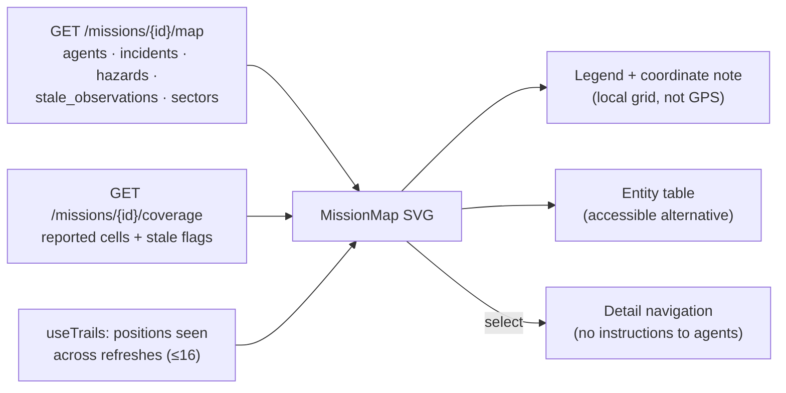

# Phase 8 dashboard: architecture, routing, state and design system

The dashboard (`frontend/`) is a React 18 + TypeScript (strict) single-page application built
with Vite. It visualizes reported simulation state and relays human-oversight decisions. It
contains no reasoning: Model 1, Model 2 and the coordinator remain the only producers of
assessments, and the backend remains the authority for permissions and validation.

## Technology choices

| Concern | Choice | Note |
|---|---|---|
| UI | React 18.3, React Router 6.28 (lazy routes) | |
| Server state | TanStack Query 5.62 | mode- and mission-scoped keys |
| Client state | Zustand 4.5 | session, preferences, activity, connection, current mission |
| Contracts | Zod 3.23 | every backend response validated at runtime |
| Charts | Recharts 2.13 | animations disabled, text summaries |
| Map | Hand-written SVG | local grid; no map service, no GPS |
| Icons | lucide-react | |
| Styling | CSS custom-property design tokens | Tailwind/shadcn not adopted: the MVP palette and plain CSS were preserved, and native `<dialog>` gives accessible modals without a component library |
| Tests | Vitest + Testing Library, Playwright (+ axe-core) | MSW not adopted: providers are injected, so tests stub the `DataProvider` directly |

## Layering



Rules enforced in code:

- UI code imports data only through hooks and the `DataProvider` interface. ESLint forbids
  `features/`, `components/` and `pages/` from importing `providers/synthetic/**`.
- `dangerouslySetInnerHTML` is forbidden by lint; all backend text renders as React text.
- Contracts live in `src/contracts/` and are the only place response shapes are declared.

## Routing

| Path | View | Permission gating (UI only; backend authoritative) |
|---|---|---|
| `/login` | Sign in, choose data source | public |
| `/missions` | Mission list, create mission | create: global coordinator/administrator |
| `/missions/:id/overview` | Overview, lifecycle controls, map, queue, events | control: `mission.control` |
| `/missions/:id/map` | Full map, layers, entity list | read |
| `/missions/:id/fleet`, `/fleet/:agentId` | Model 1 fleet, agent detail | read |
| `/missions/:id/observations` | Observation center | read |
| `/missions/:id/evidence` | Evidence center | read |
| `/missions/:id/incidents`, `/incidents/:incidentId` | Incident list and workspace | actions per incident permission |
| `/missions/:id/model2` | Model 2 monitoring | read |
| `/missions/:id/recommendations`, `/recommendations/:recId` | Recommendation center, versions | decide/confirm |
| `/missions/:id/review` | Review queue, alerts, decisions, overrides | decide, `alert.acknowledge`, `mission.override` |
| `/missions/:id/coordination` | Tasks, sectors, conflicts | read |
| `/missions/:id/environment` | Hazards | read |
| `/missions/:id/communication` | Network topology and metrics | read |
| `/missions/:id/events` | Unified timeline | read |
| `/missions/:id/analytics` | Measured metrics, exports | `metrics.read`, exports |
| `/experiments` | Phase 5/6 comparisons | global researcher/administrator |
| `/system` | Health | details: administrator |
| `/settings` | Preferences | any |
| `*` | Not found | |

`RequireAuth` guards every route except `/login`. `MissionLayout` loads the mission first: a 404
(also returned for missions the user cannot see) or 403 renders an explicit state, never a
partially populated page. Each route is lazy-loaded and wrapped in an error boundary that is
reset on navigation.

## State management

```mermaid
flowchart LR
  subgraph Persisted["localStorage (non-sensitive only)"]
    P[preferences: theme, density, layers,\ntime display, reduced motion, playback speed]
  end
  subgraph Session["sessionStorage (tab-scoped)"]
    M[data mode]
    R[refresh token — connected mode only]
  end
  subgraph Memory["memory only"]
    A[access token]
    QC[Query cache\n[mode, 'mission', id, scope, ...]]
    ACT[activity: ≤400 events, ≤100 notifications]
    CON[connection: stream status, API samples ≤300]
  end
  Logout((logout / mode switch / session expiry)) -->|clear| QC
  Logout -->|clear| ACT
  Logout -->|clear| A
  Logout -->|clear| R
```

- Query keys always begin with the data mode, then the mission ID, so caches never mix
  between connected and synthetic sources or between missions.
- Mission data refreshes every 4 s while the event stream is down and every 15 s while it is
  open; stream events invalidate only the affected scopes, batched every 400 ms.
- Mutations are never retried automatically. Idempotent GETs retry once on network, timeout or
  5xx errors.
- Missions, records and decisions are never written to browser storage.

## Mode separation



- The active mode is shown in the top bar on every page. Synthetic mode adds a persistent
  amber banner and SYNTHETIC tags on metrics, charts, map legend, notifications and exports.
- When the backend is unreachable, connected mode shows the failure and last-known data
  marked as stale. It offers retry or an explicit switch to synthetic mode; it never
  substitutes synthetic data on its own.
- Synthetic decisions change only in-browser state. A unit test asserts that the synthetic
  provider makes no `fetch` calls, and the mock e2e suite asserts that no `/api` or `/ws`
  request is made.

## Simulation visualization



- Coordinates are local cells (`crs "swarm-aid:grid"`). Items with missing, non-local or
  out-of-bounds locations are counted and listed but not drawn; nothing defaults to (0,0).
- Stale positions use dashed outlines and the "(stale)" label. Marker interpolation is
  display-only, is labelled in the legend, and stops for stale agents or with reduced motion.
- Trails are positions this browser has observed. They are not a full flight log; the agent
  page lists the persisted position history.

## Design system

Tokens are defined in `src/styles/tokens.css` for dark (default, the MVP palette) and light
themes: surfaces, text, accent, status (ok/warn/bad/info/unknown), map layers, charts, spacing,
radius, density and large-text scale. Components in `src/components/ui/`:

- **primitives**: Button, StatusBadge (colour + glyph + text), SourceTag, Panel (named region),
  Kv, Metric, PageHeader, Bar (meter)
- **states**: Skeleton, EmptyState, ErrorState (with retry, error code and request ID),
  AlertBox, QueryView (loading → error → stale-data banner → content)
- **dialogs**: Modal, Drawer and ConfirmDialog on native `<dialog>`
- **data**: DataTable (sortable, unknown values sort last, keyboard row selection), Pagination,
  SelectField, SearchField, TextField, Tabs (arrow-key navigation)
- **charts**: SeriesChart and MeanBarChart with `<figcaption>` text summaries

Status is never colour-only. Each tone has a glyph (● ▲ ■ ◆ ○ ★) and a text label.
