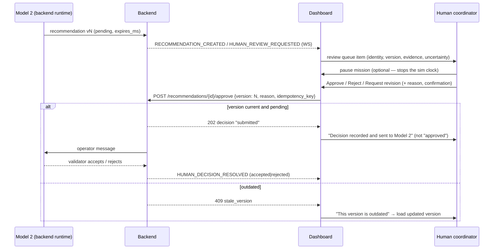

# Phase 8 dashboard: human oversight, monitoring views, research analytics and synthetic demo

## Human review workflow

- Every decision dialog shows the exact resource ID and the version or revision being decided,
  plus the request, status, evidence count, unknowns, incident category, Model 2 urgency and
  rationale, estimated location, the supporting/conflicting balance, and the consequence of
  the action.
- A reason of 1–100 characters (matching the backend) and an explicit confirmation checkbox
  are required.
- **Review deadlines run on simulation time.** Model 2's review window is about one second of
  simulated time, which is about one second of wall-clock time at the default tick delay. The
  overview and review pages tell coordinators to pause the mission. Pending recommendations do
  not expire while paused, and decisions submitted while paused are validated on resume. This
  was verified in the connected e2e suite.
- Supported actions: approve review, confirm rescue need (simulated; disabled for hazards),
  reject, request revision. On incidents: acknowledge, request priority review, correction
  feedback, simulated resolution report, close (only after a resolution report).
- Alert acknowledgement records that a human saw the alert; it does not change the incident.
- Simulated assignment overrides (pause/resume/end) go to Model 2 coordination and are
  separate from simulation lifecycle control. Nothing in the dashboard commands a physical
  drone, and Model 1 safety gates are untouched.

## Monitoring views

| View | Shows (reported data only) | Explicitly not shown |
|---|---|---|
| Overview | metrics (agents, sightings, open incidents, pending reviews, reported coverage, hazards, comms, sim time, last sync), map, review queue, events, fleet, incidents | evaluator coverage, ground truth |
| Fleet / agent | availability, reported state, link, last report, position + uncertainty, battery (if reported), degraded sensors, tasks, status/position history, observations, events | private agent memory |
| Observations | IDs (DB, stable observation, message), reporter, kind/label, confidence, observed/received sim time, age, location, Model 2 outcome, evidence references | conversion of observations into incidents |
| Evidence | modality gallery, detail, provenance timeline, side-by-side comparison, authorized media with zoom | arbitrary URLs, filesystem paths, synthetic multimodal analysis |
| Model 2 | availability, counters, evidence groups with per-agent report counts, assessments, activity | hidden reasoning |
| Incidents | lifecycle, urgency vs confidence (separate), location, supporting/conflicting reports, assessments, recommendations, transitions, decisions | rescue confirmation claims |
| Recommendations | version, request, status, deadline, unknowns, evidence, version history and field diff, status history, decisions | real-world instructions |
| Coordination | tasks (coordinator state vs reported status vs knowledge), task history, sectors, overlap, conflicts | competing assignment logic |
| Environment | hazard label, location, reports, reporters, first/last report, freshness; "absence ≠ safety" | severity (not reported), routes |
| Communication | topology with known/degraded/down/unknown links, router metrics, degradation history, pulses for received events only | inferred link health |

## Research analytics and exports

- **Mission analytics** (`metrics.read`) come from measured backend data: time series built
  from `METRICS_UPDATED` events (reported cells, admitted findings, incidents, tasks, delivery
  ratio, mean latency), per-run operational metrics, and human review latency (`resolved_at −
  submitted_at` of persisted decisions: n, mean, median, SD, range, 95% CI). Missing values are
  shown as missing. Metric definitions and units are listed on the page.
- **Evaluator ground truth** (verified coverage, missed people) is only in the research
  export, which requires the researcher mission role. It is never shown on operational pages.
- **Exports**: operational and research, JSON and CSV, through the backend (authorization and
  mission isolation enforced there). They include reproducibility metadata: scenario, seed,
  agent count, coordination policy, Model 2 mode, backend version, and per-run software
  version and git commit. Downloaded CSV is re-encoded so formula-like cells are prefixed with
  `'`. Synthetic exports are labelled SYNTHETIC in the file name and content.
- **Experiment results** (global researcher/administrator) read stored Phase 5 coordination
  and Phase 6 Model 2 baseline comparisons through `GET /experiments`. Rows are grouped by
  scenario × agents × policy or mode. The page shows n, mean, median, SD, a Student-t 95% CI
  (n ≥ 2) and missing counts, with a bar chart, metadata, definitions and a summary CSV.
  Baseline identifiers: `independent`, `fixed_sector`, `shared_information` (coordination);
  `direct`, `rules`, `fusion` (Model 2). Trained-model and MARL results are later phases.

## Synthetic demonstration

The presentation MVP's deterministic playback was ported to
`src/services/providers/synthetic/engine.ts`. It now produces records in the exact backend
contract shapes, so every page renders synthetic and connected data the same way. Presets:

| Preset | Demonstrates |
|---|---|
| Six-agent flood (default) | sector sweep, short command-link outage, sighting fusion, human review |
| Wildfire / Earthquake | other hazard labels |
| Conflicting evidence | contradicting reports, conflicting-observation counts |
| Communication degradation | long outage, stale positions, queued reports delivered on recovery |
| Model 2 unavailable | assessments pause, reports queue, recovery |
| Missing modalities | degraded thermal sensors, evidence without thermal |
| Recommendation version conflict | first decision rejected as `stale_version` |
| Empty mission | empty states |
| Backend failure | error and retry states |

Controls: sign in as a demonstration role (coordinator, operator, researcher, observer, using
the same permission matrix), start/pause/resume/stop with confirmation, playback 0.5–8×, step,
and reset. Hidden synthetic "truth" (people, buildings, hazard cells) only drives the synthetic
sensor model and is never returned by any query. A unit test checks the map output.

Synthetic state lives in browser memory only: reloading the page returns to sign-in and
restarts the demo.
