# Integrated system architecture (Phase 9)

This describes the system as implemented and verified in Phase 9. Planned or unsupported
capabilities are marked as such. SWARM-AID is a civilian disaster search-and-rescue
**simulation** research framework: there is no physical drone control and no real-world rescue
execution anywhere in the code.

## 1. Integrated system

One running mission is one `SimulationContext` (`backend/integrations/simulation_adapter.py`).
The backend and the headless profile build exactly the same context, so a headless run and a
connected mission execute the same integrated stack.

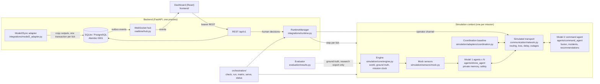

Responsibilities (unchanged from Phases 2 to 8):

| Component | Owns | Does not own |
|---|---|---|
| Engine | world state, ground truth, mission clock, movement resolution | any reasoning |
| Model 1 (`DroneAgent`) | local perception, private memory, local world model, intent, planning, independent safety check | other agents' memory, ground truth |
| Transport (`Router`, `SimulationNetwork`) | delivery, loss, delay, duplicates, partitions, endpoint availability, receipts | message meaning |
| Coordination (`AssignmentFixture` + `Baseline`) | survey tasks, task history, availability | agent actions (agents validate leases) |
| Model 2 (`CommandAgent`) | report validation, evidence fusion, incidents, urgency, recommendations, decision validation | persistence, authorization |
| Backend | authentication, authorization, persistence, event outbox, orchestration of mission lifecycle | assessment or recommendation logic |
| Dashboard | display of authorized information, human review input | any reasoning; synthetic data in connected views |
| Evaluator | ground-truth metrics for research export | operational decisions |
| `orchestration/` (Phase 9) | configuration checks, execution profiles, run manifests, owned backend process | a second lifecycle manager: missions still run through `RuntimeManager` |

## 2. Component dependencies

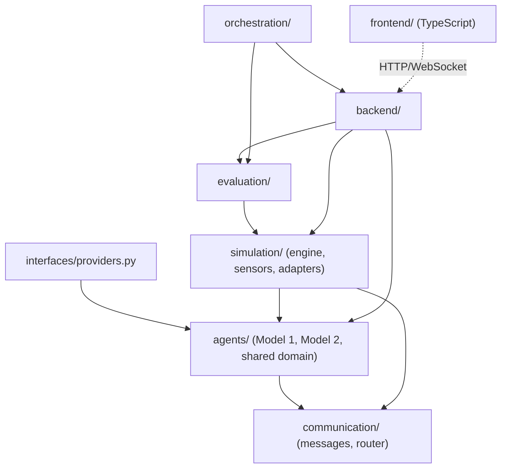

There are no import cycles: `orchestration.manifest` is imported lazily by
`backend.integrations.runtime.git_commit`, and `orchestration` imports only
`backend.integrations.simulation_adapter` (no web framework) for headless runs.

## 3. Startup sequence (`scripts/start_system.ps1`)

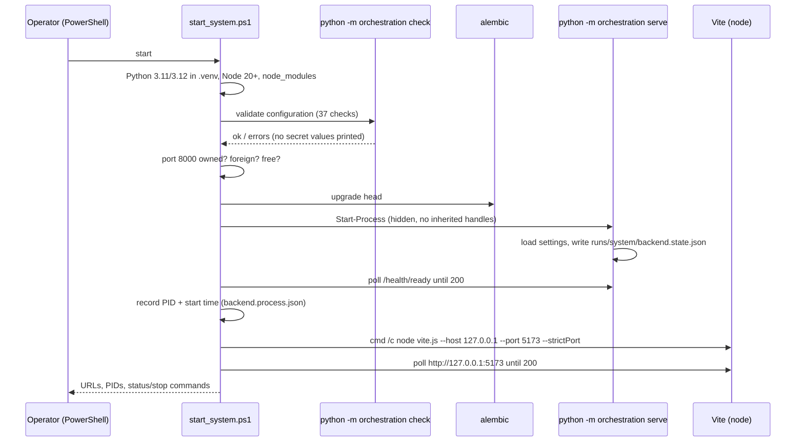

## 4. Mission lifecycle

Authoritative states live in `missions.status` and are changed only by
`backend.integrations.runtime.transition_mission`, which writes `mission_status_history` and an
outbox event in the same transaction.

```mermaid
stateDiagram-v2
  [*] --> draft: POST /missions (validated MissionConfig)
  draft --> running: start (only from draft; duplicate start -> 409 duplicate_execution)
  running --> paused: pause
  paused --> running: resume
  running --> completed: horizon reached or no active drones
  running --> stopped: stop / backend shutdown
  paused --> stopped: stop / backend shutdown
  running --> failed: simulation error or 20 consecutive persistence failures
  paused --> failed
  completed --> [*]
  stopped --> [*]
  failed --> [*]
```

A mission left `running` or `paused` by a process that died without graceful shutdown is marked
`stopped` ("backend restarted; in-memory simulation state was not durable") at the next
startup. Simulations cannot resume: simulator state is not durable (see FAILURE_RECOVERY.md).

## 5. Model 1 information flow

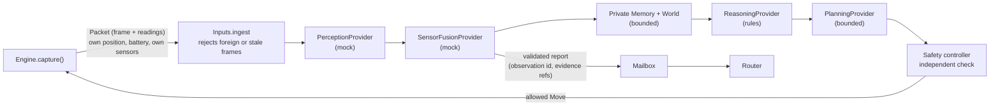

## 6. Model 1 and Model 2 interaction

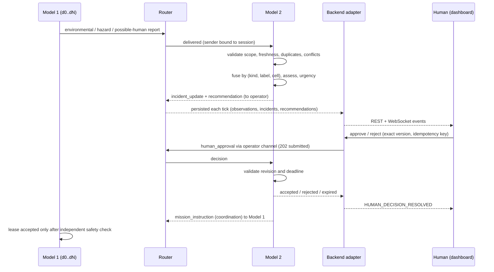

## 7. Communication flow

Peer-to-peer traffic between drones goes through the same simulated router as drone-to-command
traffic; it never passes through the dashboard or database. Under `shared_information`, drones
exchange reports and health; under `fixed_sector` and `independent`, peer sharing is off.

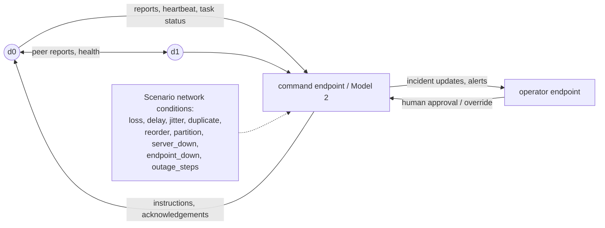

## 8. Evidence provenance

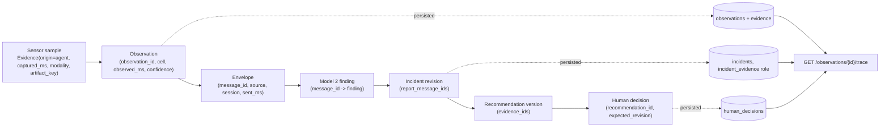

Evidence `origin` is checked in tests to equal the reporting agent at every stage
(`tests/integration/test_system_integration.py`). The trace endpoint returns persisted records
only: no private agent memory, no Model 2 internals, no ground truth.

## 9. Human review workflow

Recommendation versions (`recommendations.status`):

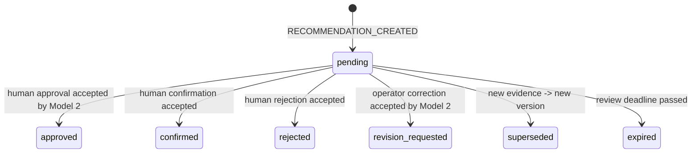

Human decisions (`human_decisions.status`), which are separate records:

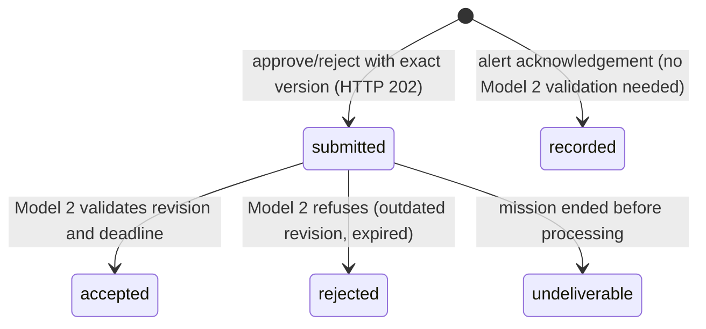

Approval is decision support. It is never treated as a successful rescue outcome.

Stale versions are refused before submission (409 `stale_version`); repeated submissions with
the same idempotency key return the same decision.

## 10. Backend persistence

Each tick: `RuntimeManager._tick` steps the context and `Model2Sync.sync` copies new outputs in
one transaction (observations, evidence, incidents, revisions, evidence links, recommendations,
transitions, alerts, tasks, agent reports, runtime state, outbox events). If the transaction
fails, adapter cursors are restored and the next tick persists the same data again; after 20
consecutive failures the mission is marked `failed`. Every `snapshot_every_ticks` ticks a
Model 2 checkpoint, its read model and the coordination snapshot are stored with SHA-256
digests.

## 11. WebSocket synchronization

```mermaid
sequenceDiagram
  participant C as Client
  participant H as Hub
  participant DB as Outbox
  C->>H: connect /ws/v1/missions/{id}
  C->>H: {"type":"auth","token":...} (never in the URL)
  H-->>C: welcome(last_sequence)
  C->>H: subscribe(after_sequence = last seen)
  H->>DB: replay events > after_sequence (up to 1000)
  H-->>C: event frames, strictly increasing sequence
  Note over H,C: heartbeat every N s; bounded queue per client
  H-->>C: resync_required + close 4008 if the client falls behind
  C->>DB: REST /events?after_sequence=n to resynchronise
```

Delivery is at-least-once with client-side de-duplication by `sequence`; exactly-once is not
claimed. Phase 9 verified disconnect and replay against the running system: 219 events seen,
reconnect with `after_sequence=220`, replay started at 221 with no gaps
(`runs/phase9/demo/demo-20261124T154241Z.json`).

## 12. Failure recovery

See FAILURE_RECOVERY.md for categories. Recovery levels actually supported:

| Level | Supported |
|---|---|
| Historical record recovery after backend restart | Yes (verified) |
| Mission metadata recovery | Yes (verified) |
| Model 2 memory restore from checkpoint (read model integrity) | Yes, on request (`POST /missions/{id}/model2/recovery`), verified |
| Agent (Model 1) state recovery | No: not persisted |
| Exact simulation continuation after interruption | No: missions are marked stopped |

## 13. Research evaluator isolation

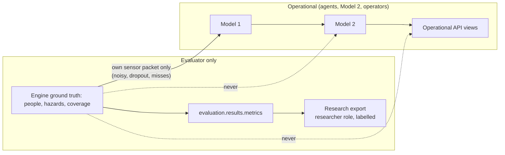

Verified by an object-graph test (no `Engine`, `Person`, `Hazard`, `Drone` or another agent's
memory is reachable from any Model 1 agent, and none is reachable from Model 2) and by a
key-level scan of every operational endpoint (SECURITY_AND_ISOLATION.md).

## 14. Future trained-provider integration (planned, not implemented)

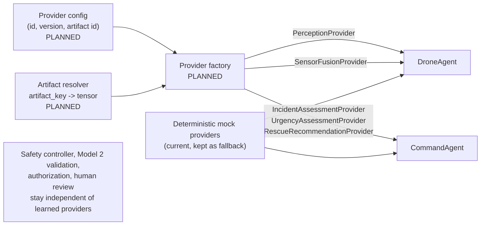

The provider ports exist (`interfaces/providers.py`) and both agents accept injected providers;
the factory, configuration and artifact resolver do not exist yet. See
`docs/research/MODEL_PROVIDER_READINESS.md`.
