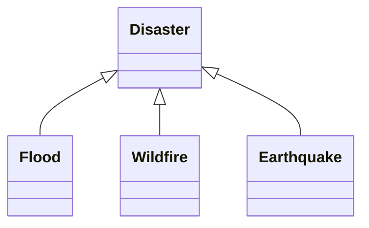

# ENVIRONMENT DESIGN

Flood defaults to dry ground with symbolic water. Wildfire uses forest and fire. Earthquake uses roads and debris. Scheduled cell replacements are the entire environmental evolution law. Register another Disaster subclass to provide a new ground and hazard category. All movement uses Manhattan neighbors. Roads and water are aerially traversable; buildings, rubble and restricted cells veto entry.

