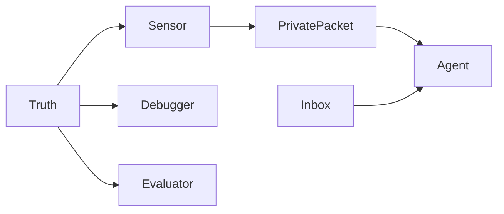

# OBSERVATION AND ACTION SPACES

Policies receive immutable packets containing a Phase 1 SensorFrame and its scoped symbolic readings. No seed, truth IDs, event schedule or evaluator counters are present. Received envelopes use a separate inbox. Actions 0 through 9 mean hold, north, east, south, west, observe, request, report, return and inactive. Sensors sample every active tick. Request records a request for the next scheduled observation. Report transmits a delivered evidence reference to the command inbox, preferring a possible-human reading. Return attempts one direct grid step. Contested cells and swaps veto movement. Each tick costs one battery point plus one per successful move.

