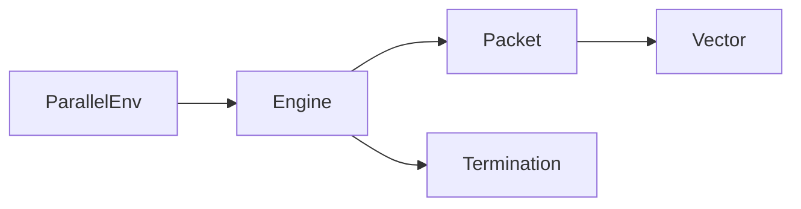

# PETTINGZOO INTEGRATION

Instantiate RescueEnv(load('flood_basic')). reset(seed=...) returns observations and empty info dictionaries. Each int32 vector contains observed x, y (or -1), battery percentage and delivered candidate count. Discrete(10) selects a simulated action. Reward is always zero. Inactive agents terminate and surviving agents truncate at the horizon. This projection is intended for API tests.

