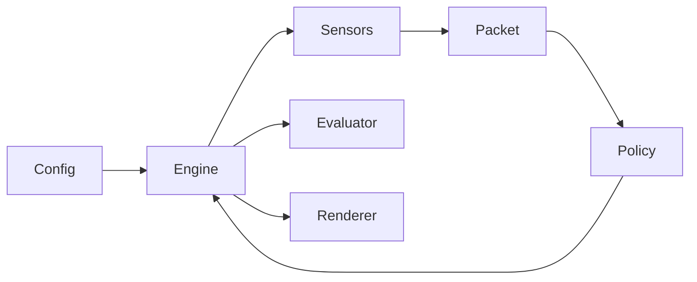
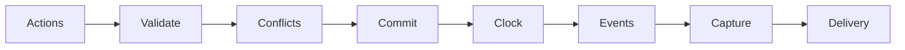

# SIMULATION ARCHITECTURE

The CLI owns the engine, invokes a baseline on each private packet and submits a simultaneous action dictionary. Terrain and person identity belong to the environment. Evaluation consumes privileged capture counters. Reset reconstructs state and independent random streams.

