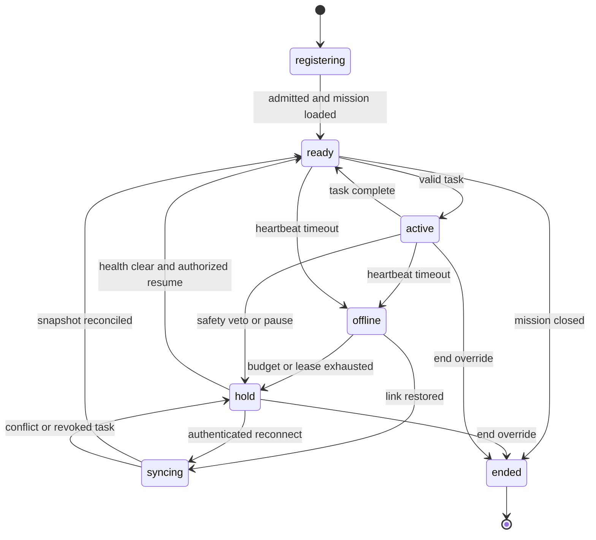

# Agent lifecycle

Safety and mission-end guards are evaluated before every action in every state. Registering, syncing and hold permit zero movement. Offline allows only previously authorized work within the lease. An end override is terminal from any live state once received. A reserve breach enters hold or ends the episode under the scenario policy. Resume requires a valid current mission and cannot clear a persistent safety fault.

Command starts by restoring its last committed mission revision, enters intake only after recovery, then cycles through validate, associate, assess, validate proposal and await review. A conflicting update restarts assessment from the newest revision. Shutdown flushes committed events and closes subscriptions. The incident state diagram is in the Model 2 architecture.
