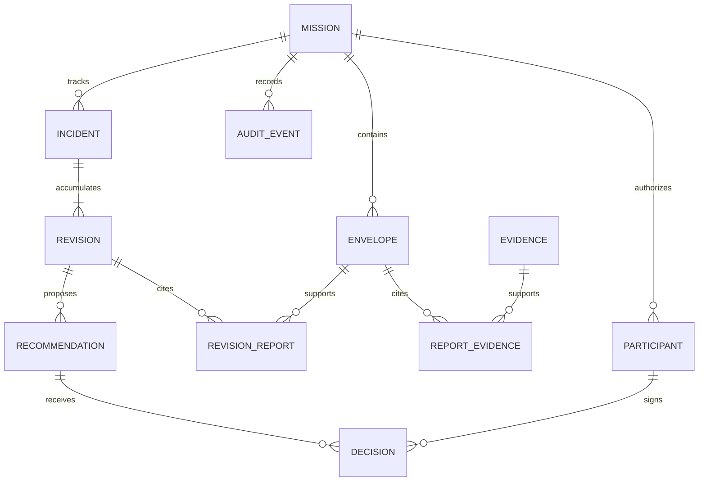

# Planned relational schema

Use PostgreSQL with SQLAlchemy migrations in the backend phase. Scope child keys and foreign keys by mission_id. MISSION stores scenario, lifecycle, seed, config digest and current override revision. PARTICIPANT binds principal, role, session and mission. ENVELOPE stores immutable wire bytes or canonical digest, source, destination, send and receive times, discriminator and disposition. Enforce unique message ID within mission and unique sender-session/destination sequence. Group deliveries get a recipient receipt table.

INCIDENT has a stable ID; REVISION is keyed by (mission_id, incident_id, revision). REVISION_REPORT and REPORT_EVIDENCE use composite foreign keys to scope both ends. EVIDENCE stores capture time, artifact key, content hash, modality and provenance. RECOMMENDATION pins revision and expiry; a join table records cited evidence. DECISION pins recommendation and revision, authenticated reviewer, decision and rationale. AUDIT_EVENT records correlation, previous and next revisions and reason. Store mission overrides as mission-level audited events independent of a recommendation.

Index mission/time for replay, incident/revision for reads and evidence origin/time for association. Synthetic positions are integer grid cells. Reserve PostGIS geometry and GiST indexes for explicitly georeferenced future scenarios with declared SRID. Commit decision, incident revision, audit and outgoing notification in one transaction using expected revision. Keep imagery outside the database behind scoped retrieval. Truth uses a separate evaluator store and credentials.
