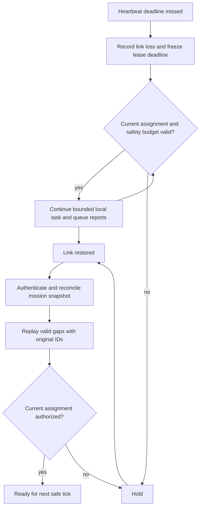

# Safety and failure handling

Offline deadline equals the earlier of task expiry and last verified command contact plus offline_budget_ms. A flapping link cannot extend it until authenticated synchronization completes. A queued instruction past expiry is discarded. A disconnected agent learns a remote override on reconnection; finite leases limit this exposure.

| Failure | Immediate response | Recovery evidence |
|---|---|---|
| Battery at reserve, invalid movement, missing localization | Safety veto; hold or end simulated episode | Health record and accepted action |
| Provider exception or invalid output | Record error and hold for the tick | New valid scoped observation and policy check |
| Conflicting reports or missing artifact | Add uncertainty, withhold unsupported proposal | Resolved evidence or human review |
| Unauthorized instruction or forged source field | Reject before state change | Audit authenticated principal and reason |
| Stale approval or repeated message | Check expected revision and receipt ledger | Conflict requiring refreshed review, or prior outcome |
| Queue overflow | Coalesce routine telemetry, log loss, enter hold if controls cannot be reconciled | Snapshot, cursor and gap audit |
| Command crash during decision | Restore committed ledger and outbox together | Replay delivery without applying decision twice |

Future imagery requires mission-scoped access, retention periods, deletion auditing and redacted exports. Validate controls with synthetic artifacts. The independent safety policy remains on the action path even after a human resume.

The instruction envelope expiry is also the latest authorized execution time for its task. Recheck it on every tick and before applying a delayed action. Hold when the next step and mandatory sensing/communication debits would cross reserve. Accept movement only for the authorized survey/revisit target, within public mission bounds and restrictions. Clip offline authority to the earlier deadline. A hazard report, peer request or planner output cannot grant a new lease. Unknown localization, missing safety inputs or a policy exception fail closed. End overrides dominate resume and all retained tasks.

In baseline experiments, the trusted local allocator may derive a target from the preauthorized public search scope only while connected and synchronized. No allocator may issue a new lease offline. Learned policies cannot extend leases. A drone-level end retires that simulated agent; mission closure remains under the authorized mission rules.
